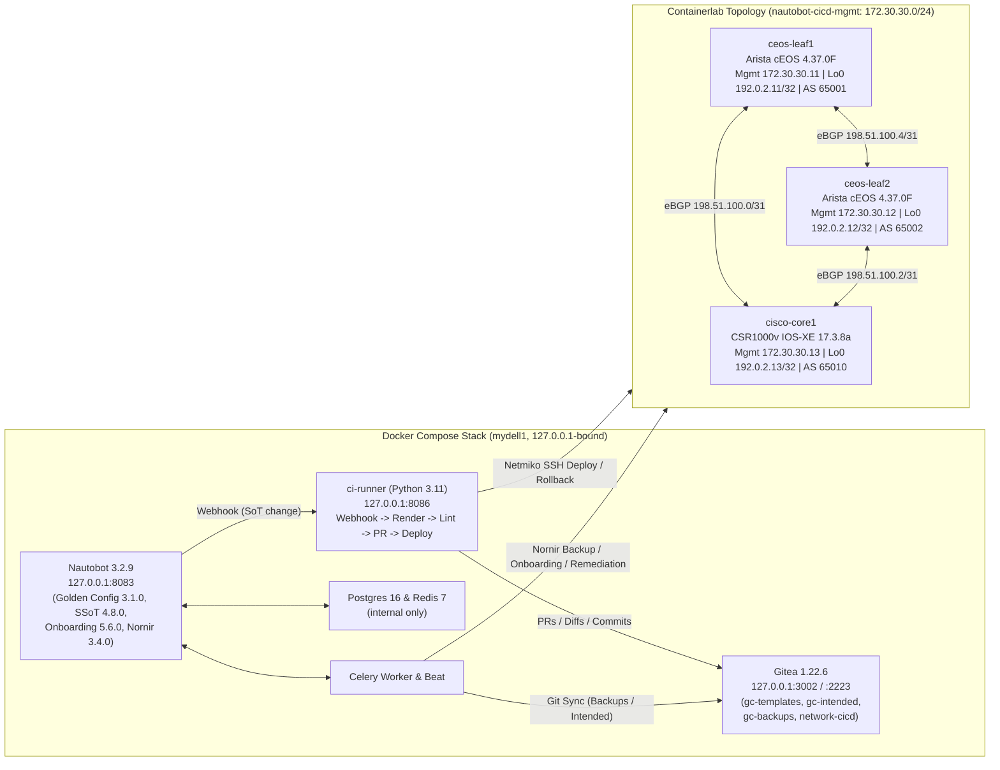

# Nautobot 3.2.9 Network CI/CD, Golden Config & Drift Remediation Lab

A hands-on, multi-vendor Network CI/CD lab built as an operational follow-on to the Nautobot 3.2.9 review. Rather than stopping at IPAM and DCIM modeling, this lab demonstrates **Nautobot's operational differentiation versus NetBox**: turning the Source of Truth (SoT) into an active automation, compliance, and remediation engine using Nautobot's integrated app ecosystem (`nautobot_golden_config`, `nautobot_device_onboarding`, `nautobot_ssot`, and `nautobot_plugin_nornir`), native Jobs, GraphQL, Git Repositories, and Webhooks—tested against live Arista cEOS and Cisco CSR1000v routers.

All addressing uses strictly **RFC 5737** documentation ranges (`192.0.2.0/24`, `198.51.100.0/24`, `203.0.113.0/24`) plus an isolated Containerlab management subnet (`172.30.30.0/24`). Every published host port is bound strictly to `127.0.0.1`.

---

## Lab Host & SSH Port Forwarding

The stack and Containerlab topology run on Linux host **`mydell1`** under `/home/superuser/ag-lab/nautobot-cicd-1121`.

Open an SSH tunnel from your workstation to reach the loopback-bound web UIs:

```bash
ssh -N \
  -L 8083:127.0.0.1:8083 \
  -L 3002:127.0.0.1:3002 \
  mydell1
```

Optional: add `-L 8086:127.0.0.1:8086` if you want to query the CI webhook receiver's `/health` endpoint directly from your workstation.

### Published & Internal Ports

| Service | Host Binding (`mydell1`) | Container Port | Access |
| --- | --- | --- | --- |
| Nautobot 3.2.9 Web UI / API | `127.0.0.1:8083` | `8080/tcp` | Loopback only (SSH `-L 8083`) |
| Gitea 1.22.6 Web UI / API | `127.0.0.1:3002` | `3000/tcp` | Loopback only (SSH `-L 3002`) |
| Gitea SSH | `127.0.0.1:2223` | `22/tcp` | Loopback only |
| CI Webhook Receiver (`ci-runner`) | `127.0.0.1:8086` | `8086/tcp` | Loopback + Docker internal |
| PostgreSQL 16 (`postgres:16-alpine`) | Internal only | `5432/tcp` | Docker network only (not published) |
| Redis 7 (`redis:7-alpine`) | Internal only | `6379/tcp` | Docker network only (not published) |

---

## Architecture



---

## Repository Layout

- `clab/` — Containerlab topology (`topology.clab.yml`), startup configs (`configs/ceos-leaf1.cfg`, `ceos-leaf2.cfg`, `cisco-core1.cfg`), and `bootstrap_cisco.py`.
- `compose/` — Custom Nautobot 3.2.9 `Dockerfile`, `Dockerfile.ci`, `nautobot_config.py`, `docker-compose.yml`, and `.env.example`.
- `testdata/` — RFC 5737 fixtures (`fixtures.yaml`), `config_contexts/global_services.json`, and idempotent `seed_nautobot.py`.
- `templates/` — Jinja2 templates (`main.j2`, `arista_eos.j2`, `cisco_xe.j2`, `cisco_ios.j2`) and `compliance_features.yaml`.
- `scripts/` — `configure_nautobot_apps.py` (Gitea repos, Nautobot Secrets, Git Repositories, Golden Config rules/remediation, Webhook) and `onboard_devices.py`.
- `pipeline/` — `webhook_server.py` (debounced receiver), `run_cicd.py` (7-stage CI/CD pipeline), and `rollback.py` (Git-backed rollback).
- `tests/` — Reproducible end-to-end test runner (`run_e2e_tests.py`, T1–T7).
- `evidence/` — Raw observed outputs (`t1_health_ports.txt` through `t7_rollback.txt` and `summary.json`).

---

## How to Run (on `mydell1`)

> **Lab-only credentials note:** Copy `compose/.env.example` to `compose/.env` and set your own lab-only values before starting. Never commit `.env` or API tokens.

```bash
cd /home/superuser/ag-lab/nautobot-cicd-1121

# 1. Deploy the 3-router Containerlab topology (creates nautobot-cicd-mgmt 172.30.30.0/24)
sudo clab deploy -t clab/topology.clab.yml
python3 clab/bootstrap_cisco.py

# 2. Build and start the Docker Compose stack (Nautobot, Celery, Postgres, Redis, Gitea, ci-runner)
cp compose/.env.example compose/.env   # populate lab-only env vars & NAUTOBOT_SUPERUSER_API_TOKEN
docker compose -f compose/docker-compose.yml up -d --build

# 3. Seed baseline IPAM, VLANs, ConfigContext, and site metadata in Nautobot
python3 testdata/seed_nautobot.py

# 4. Configure Gitea repos, Nautobot Secrets, Golden Config rules, HierConfig remediation, and Webhook
python3 scripts/configure_nautobot_apps.py

# 5. Run live Device Onboarding (auto-discovers ceos-leaf1 & ceos-leaf2) and enrich inventory
python3 scripts/onboard_devices.py
python3 testdata/seed_nautobot.py --include-devices

# 6. Run the full T1-T7 end-to-end verification suite
python3 tests/run_e2e_tests.py
```

---

## Observed Results Summary (`evidence/`)

All 7 end-to-end tests passed (**7/7 PASS**, recorded `2026-11-22T06:38:39Z` on `mydell1`; full logs in `evidence/summary.json` and `evidence/t1_*.txt`–`t7_*.txt`):

| Test | Check | Observed Result |
| --- | --- | --- |
| **T1** | Health & Port Bindings (`t1_health_ports.txt`) | **PASS** — All 7 Compose services `(healthy)`; 3 Containerlab routers running (`172.30.30.11`–`.13`); `ss -lnt` confirms `127.0.0.1`-only listeners on `8083`, `3002`, `2223`, `8086` (Postgres `5432` & Redis `6379` internal only in Compose). |
| **T2** | Nautobot Apps & Versions (`t2_apps_status.txt`) | **PASS** — Nautobot `3.2.9` (Django `5.2.19`, Python `3.11.18`, `celery-workers-running: 1`), `nautobot_plugin_nornir 3.4.0`, `nautobot_ssot 4.8.0`, `nautobot_device_onboarding 5.6.0`, `nautobot_golden_config 3.1.0`; Gitea `1.22.6`; webhook `/health` HTTP 200. |
| **T3** | Device Onboarding & eBGP (`t3_onboarding_bgp.txt`) | **PASS** — `SSOTSyncDevices` completed with `SUCCESS`, auto-discovering `ceos-leaf1` and `ceos-leaf2` over SSH; all 3 devices registered in Nautobot; all 6 live eBGP peerings `Established` (`ceos-leaf1` AS 65001, `ceos-leaf2` AS 65002, `cisco-core1` AS 65010). |
| **T4** | Baseline Compliance (`t4_baseline_compliance.txt`) | **PASS** — Golden Config `BackupJob` and `ComplianceJob` `SUCCESS`; **20/20** feature checks compliant (`ceos-leaf1` 7/7, `ceos-leaf2` 7/7, `cisco-core1` 6/6). |
| **T5** | SoT Change -> Webhook -> CI/CD (`t5_sot_cicd_deploy.txt`) | **PASS** — `seed_nautobot.py --apply-demo-change` created VLAN `300` (`LAB-CI-DEMO`), prefix `203.0.113.128/26`, updated `ceos-leaf1:Ethernet2` description to `Uplink to ceos-leaf2 - CI/CD Managed`, and added `cisco-core1:Loopback10` (`203.0.113.250/32`). Nautobot webhook fired to `ci-runner:8086` (coalescing 18 burst events), passed lint, opened and merged Gitea **PR #68** (from baseline commit `b19a88ee7e`), deployed via Netmiko, verified on router CLI, and confirmed **20/20** post-deploy compliance. |
| **T6** | Manual Drift & Remediation (`t6_drift_remediation.txt`) | **PASS** — Injected live out-of-band drift (`ceos-leaf1`: removed `lab-ro-demo`, added `DRIFT-BAD` and `logging host 192.0.2.250`; `cisco-core1`: removed `lab-ro-demo`, added `DRIFT-BAD`). Golden Config detected **17/20** compliant (`ceos-leaf1:logging`, `ceos-leaf1:snmp`, `cisco-core1:snmp` non-compliant with exact missing/extra lines). `GenerateConfigPlans` created 2 HierConfig remediation plans; `DeployConfigPlans` succeeded; live CLI confirmed drift removed and `lab-ro-demo` restored; compliance returned to **20/20**. |
| **T7** | Rollback & SoT Revert (`t7_rollback.txt`) | **PASS** — `pipeline/rollback.py --commit b19a88ee7e` opened and merged Rollback **PR #69**, removed VLAN `300` and `Loopback10` and restored `ceos-leaf1:Ethernet2` description (`Peer link to ceos-leaf2 Ethernet2`) on live routers; `seed_nautobot.py --revert-demo-change` synced SoT back to baseline; final compliance confirmed **20/20**. |

---

## Honest Lab Limits & Caveats

1. **Cisco CSR1000v vrnetlab NAT Onboarding Caveat:** Inside Containerlab (`generic_vm`), the CSR1000v vrnetlab wrapper NATs the container management IP `172.30.30.13` to `GigabitEthernet1` (`10.0.0.15/24`) inside the guest VM. During `SSOTSyncDevices`, Nautobot successfully connects over SSH and runs `show version`, `show interfaces`, `show switch detail`, and `show module`, but its default Jinja management-interface extractor fails to match `172.30.30.13` against `10.0.0.15/24`. Running `testdata/seed_nautobot.py --include-devices` cleanly registers `cisco-core1` in Nautobot alongside the auto-onboarded `ceos-leaf1` and `ceos-leaf2`, after which Golden Config backup, compliance, CI/CD deployment, and HierConfig remediation all work end-to-end on `cisco-core1`.
2. **CSR1000v L3-Only VLAN Behavior:** Cisco CSR1000v (`IOS-XE 17.3.8a`) is a pure Layer 3 router and does not support a Layer 2 `vlan` database. Accordingly, `vlans` compliance is evaluated on `ceos-leaf1` and `ceos-leaf2` (7 features each) while `cisco-core1` is evaluated on 6 features (`bgp`, `hostname`, `interfaces`, `logging`, `ntp`, `snmp`), totaling **20** compliance checks across the 3-router topology.
3. **Intended Config Rendering Ownership:** In T4, Nautobot's built-in `IntendedJob` logged an `UndefinedError: 'name' is undefined` when invoking `main.j2` through `nornir_nautobot`'s template context, while the CI/CD pipeline (`pipeline/run_cicd.py`) renders `templates/` cleanly from Nautobot's GraphQL/REST data, lints the output, opens Gitea PRs, and commits the intended configs to `netops/gc-intended`. Nautobot's `ComplianceJob` then pulls `netops/gc-intended` and `netops/gc-backups` directly from Gitea to compute the full 20/20 compliance matrix and HierConfig remediation plans.
4. **Auto-Merge in Lab CI/CD:** For automated end-to-end demonstration, `pipeline/run_cicd.py` auto-merges passing Gitea PRs after lint and dry-run diff checks succeed. In production, you would require human PR approval on `main` before triggering the deploy stage.
