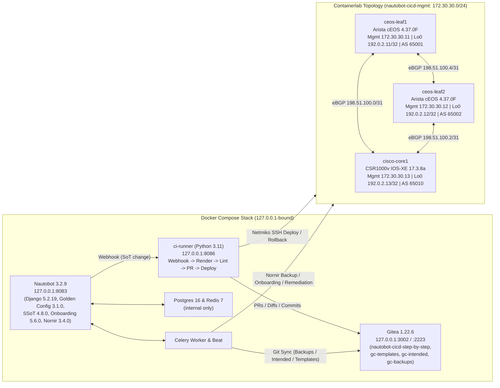

# Nautobot 3.2.9 Network CI/CD Step-by-Step Beginner Lab

Video: [Nautobot CI/CD Step-by-Step for Beginners: Git, Pipelines, Drift & Rollback](https://youtu.be/R4y4kGmiVS8)

A complete, beginner-friendly, hands-on Network CI/CD lab built from scratch with **Nautobot 3.2.9**, **Git**, **local Gitea 1.22.6**, **Python**, **Jinja2**, **Golden Config**, **HierConfig**, and a live 3-router **Containerlab** topology (`ceos-leaf1`, `ceos-leaf2`, and `cisco-core1`).

Every IP address in this lab uses **RFC 5737** documentation ranges (`192.0.2.0/24`, `198.51.100.0/24`, `203.0.113.0/24`) plus an isolated Containerlab management subnet (`172.30.30.0/24`). Every published host port binds strictly to `127.0.0.1`.

---

## Core Concepts (Plain English)

- **Nautobot (Source of Truth):** A web application and database where the *intended* state of your network lives — devices, interfaces, IP addresses, VLANs, BGP AS numbers, and global services. Instead of guessing what a router should look like, automation reads Nautobot.
- **Django:** The Python web framework that Nautobot is built on. It provides Nautobot's web pages, database models, admin interface, and REST/GraphQL APIs.
- **Git Repository:** A folder whose change history is tracked snapshot by snapshot (`commit`). Branches let you isolate a change, compare it in a Pull Request (PR), and undo it cleanly (`rollback`) if needed.
- **Local Gitea:** A self-hosted Git server running inside Docker on `127.0.0.1:3002`. It works just like GitHub (hosting repositories, branches, diffs, and Pull Requests) while keeping the entire lab private and local.
- **CI/CD for Networking:**
  - **CI (Continuous Integration):** Automatically render configs from Nautobot, lint them for syntax/policy errors, and compute a dry-run diff on every change.
  - **CD (Continuous Deployment/Delivery):** Automatically open and merge the reviewed Pull Request, push the approved config delta to routers, and verify Golden Config compliance.

---

## Architecture



---

## Folder Layout

| Folder / File | Purpose |
| --- | --- |
| `compose/` | `docker-compose.yml`, custom Nautobot `Dockerfile`, `Dockerfile.ci`, `nautobot_config.py`, and `.env.example` (copy to `.env` locally; never commit real tokens). |
| `clab/` | Containerlab topology (`topology.clab.yml`), router startup configs (`configs/ceos-leaf1.cfg`, `ceos-leaf2.cfg`, `cisco-core1.cfg`), and `bootstrap_cisco.py`. |
| `templates/` | Jinja2 config templates (`main.j2`, `arista_eos.j2`, `cisco_xe.j2`, `cisco_ios.j2`) and `compliance_features.yaml`. |
| `testdata/` | RFC 5737 fixtures (`fixtures.yaml`), `config_contexts/global_services.json`, and idempotent `seed_nautobot.py`. |
| `pipeline/` | `webhook_server.py` (debounced webhook receiver), `run_cicd.py` (7-stage CI/CD runner), and `rollback.py` (Git-backed rollback to a prior baseline commit). |
| `scripts/` | `configure_nautobot_apps.py` (sets up Gitea repos, Secrets, Git Repositories, Golden Config rules, Webhook), `onboard_devices.py`, and `trigger_golden_config.py`. |
| `tests/` | Full end-to-end verification suite (`run_e2e_tests.py`). |
| `evidence/` | Clean, sanitized observed outputs from the step-by-step lab run. |
| `.gitignore` | Prevents local `.env`, keys, Python caches, and Containerlab runtime files from ever being committed. |

---

## Step-by-Step Walkthrough

### Part 1 — Start the Lab Stack & Open SSH Tunnels

If you run the Docker Compose stack and Containerlab on a Linux lab host (`mydell1`), forward the loopback-bound ports to your workstation:

```bash
ssh -N \
  -L 8083:127.0.0.1:8083 \
  -L 3002:127.0.0.1:3002 \
  -L 8086:127.0.0.1:8086 \
  mydell1
```

| Service | Loopback Address | Role |
| --- | --- | --- |
| Nautobot 3.2.9 | `http://127.0.0.1:8083` | Source of Truth Web UI & REST/GraphQL API |
| Gitea 1.22.6 | `http://127.0.0.1:3002` | Local Git hosting & Pull Requests |
| CI Webhook Receiver | `http://127.0.0.1:8086` | Receives Nautobot webhooks & runs `run_cicd.py` |

Deploy the topology and Docker Compose stack on your lab host:

```bash
# 1. Deploy the 3-router Containerlab topology
sudo clab deploy -t clab/topology.clab.yml
python3 clab/bootstrap_cisco.py

# 2. Configure lab-only environment variables and start Compose
cp compose/.env.example compose/.env   # set your own lab-only passwords & tokens
docker compose -f compose/docker-compose.yml up -d --build

# 3. Seed baseline IPAM, VLANs, ConfigContext, and site metadata
python3 testdata/seed_nautobot.py

# 4. Configure Gitea repos, Nautobot Secrets, Git Repositories, Golden Config, and Webhook
python3 scripts/configure_nautobot_apps.py

# 5. Onboard devices and enrich inventory
python3 scripts/onboard_devices.py
python3 testdata/seed_nautobot.py --include-devices
```

### Part 2 — Build the Git Repository from Scratch & Push to Local Gitea

```bash
mkdir nautobot-cicd-step-by-step && cd nautobot-cicd-step-by-step
git init -b main
# Add compose/, clab/, templates/, testdata/, pipeline/, tests/, scripts/, .gitignore
git status -s
git add .
git commit -m "Initial Nautobot CI/CD lab repository"

# Practice branching before pushing to local Gitea
git branch
git switch -c feat/add-vlan-300
# Edit or add a change note, stage, and commit on the feature branch
git switch main
git remote add origin http://127.0.0.1:3002/netops/nautobot-cicd-step-by-step.git
git push -u origin main
```

Then in Nautobot (**Extensibility -> Git Repositories**), connect `Golden Config Templates`, `Golden Config Intended`, and `Golden Config Backups` to local Gitea (`http://gitea:3000/netops/...`) using a Nautobot Secret token and click **Sync**.

### Part 3 — Trigger the 7-Stage CI/CD Pipeline via Nautobot Webhook

Apply the planned Source of Truth change (adds VLAN `300` `LAB-CI-DEMO`, prefix `203.0.113.128/26`, updates `ceos-leaf1:Ethernet2` description, and adds `cisco-core1:Loopback10` `203.0.113.250/32`):

```bash
docker exec nautobot-cicd-ci-runner python3 /workspace/testdata/seed_nautobot.py --apply-demo-change
```

Nautobot fires a webhook burst to `ci-runner:8086/webhook/nautobot`, which debounces/coalesces the events and runs `pipeline/run_cicd.py`:
1. **Stage 1:** Fetch SoT devices/VLANs/interfaces/prefixes from Nautobot.
2. **Stage 2:** Render Jinja2 intended configs (`arista_eos.j2`, `cisco_xe.j2`).
3. **Stage 3:** Lint rendered configs.
4. **Stage 4:** Compute dry-run diff against live routers.
5. **Stage 5:** Open and merge a Gitea Pull Request in `netops/gc-intended`.
6. **Stage 6:** Deploy config delta via Netmiko SSH.
7. **Stage 7:** Run Golden Config Backup + Compliance (`20/20`).

### Part 4 — Drift Detection (17/20), HierConfig Remediation (20/20), and Rollback

1. **Inject out-of-band drift** on `ceos-leaf1` (replace `lab-ro-demo` with `DRIFT-BAD` and add `logging host 192.0.2.250`) and `cisco-core1` (replace `lab-ro-demo` with `DRIFT-BAD`).
2. **Run Backup + Compliance:**
   ```bash
   docker exec nautobot-cicd-ci-runner python3 /workspace/scripts/trigger_golden_config.py --enable-jobs --backup-compliance
   ```
   Golden Config reports **17/20 compliant**, flagging `ceos-leaf1` (`logging`, `snmp`) and `cisco-core1` (`snmp`) in red.
3. **Remediate with HierConfig / Deploy Config Plans:**
   ```bash
   docker exec nautobot-cicd-ci-runner python3 /workspace/scripts/trigger_golden_config.py --remediate --change-id DEMO-REMEDIATE-V3
   ```
   Generates, approves, and deploys HierConfig remediation plans, restoring `lab-ro-demo`, removing `DRIFT-BAD` and `logging host 192.0.2.250`, and returning compliance to **20/20**.
4. **Rollback to the pre-change baseline commit:**
   ```bash
   docker exec nautobot-cicd-ci-runner python3 /workspace/pipeline/rollback.py --commit <PRE_CHANGE_BASELINE_SHA> --run-compliance
   docker exec nautobot-cicd-ci-runner python3 /workspace/testdata/seed_nautobot.py --revert-demo-change
   docker exec nautobot-cicd-ci-runner python3 /workspace/scripts/trigger_golden_config.py --backup-compliance
   ```
   Verify on live router CLI that `show vlan` no longer lists VLAN `300`, `show ip interface brief` no longer lists `Loopback10`, `Ethernet2` is restored to `Peer link to ceos-leaf2 Ethernet2`, eBGP remains `Established`, and compliance is **20/20**.

---

## Observed Results Summary (`evidence/`)

| Stage | Observed Result |
| --- | --- |
| **Git from Scratch** | Initialized `main` (commit ending in `b7a630`), branched `feat/add-vlan-300` (commit ending in `a2cf5c`), pushed to local Gitea `netops/nautobot-cicd-step-by-step`; Nautobot `Golden Config Templates` sync `SUCCESS`. |
| **SoT Change -> Webhook -> CI/CD** | Nautobot fired 18 webhook events (`+17 coalesced events`) to `ci-runner:8086`, `run_cicd.py` exited `rc=0`, opened & merged Gitea **PR #79** (merge commit ending in `0b70c8`), deployed VLAN `300`, `Loopback10`, and `Ethernet2` description, and verified **20/20** compliance. |
| **Drift Detection** | Out-of-band SNMP/logging changes on `ceos-leaf1` and `cisco-core1` produced **17/20** compliance (`ceos-leaf1:logging`, `ceos-leaf1:snmp`, `cisco-core1:snmp` non-compliant). |
| **HierConfig Remediation** | `GenerateConfigPlans` + `DeployConfigPlans` (`DEMO-REMEDIATE-V3`) succeeded, removed rogue SNMP/logging on live CLI, and restored **20/20** compliance. |
| **Rollback & Live Verification** | `pipeline/rollback.py` targeted pre-change baseline commit ending in `bcc431`, opened & merged Rollback **PR #81** (merge commit ending in `297e89`) with a real intended-config delta removing VLAN `300`, `Loopback10`, and restoring `Ethernet2`; live CLI confirmed VLAN `300` and `Loopback10` absent, `Ethernet2` restored, all eBGP peers `Established`, and fresh post-rollback compliance **20/20**. |
