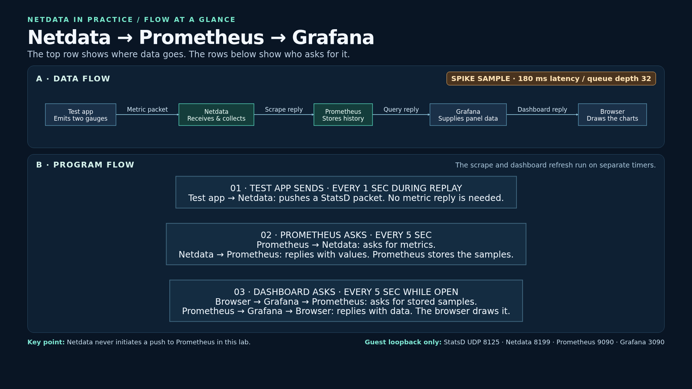

# Netdata, Prometheus, and Grafana: from metrics to a live dashboard

Build a monitoring pipeline for two synthetic application gauges: **checkout latency in milliseconds** and **queue depth as a count**. Then replay a three-minute test and verify that both curves go from **25 ms / 2 → 180 ms / 32 → 25 ms / 2**. The inputs are synthetic. The collection, history, and plotted data are real.



- **Data direction:** test emitter → Netdata → Prometheus → Grafana → browser.
- **Who initiates:** the emitter sends StatsD to Netdata. Prometheus initiates an HTTP scrape of Netdata. Grafana queries Prometheus when the browser asks for dashboard data. Netdata never pushes to Prometheus.
- The **5-second Prometheus scrape** and **5-second Grafana refresh** run on separate timers. The latest point may not be visible instantly. Samples near transitions can reflect the scrape window's average.
- The visualization shown is **Grafana**, not Netdata's native dashboard.

## Before you start

Use a dedicated **Linux amd64 lab VM** with Python 3, Docker Engine, the Docker Compose v2 plugin, and a browser running within the VM. The recorded lab used a **4-vCPU, 8 GiB** VM with Ubuntu Desktop. The Compose CPU quotas shared across the containers total 2.5 CPUs; these are not physical-core affinity controls. Use a trusted account authorized to run Docker on that VM. The helper forces the local Docker socket, not a remote Docker context.

This exercise uses **host networking within the lab VM**, not shared network services on your workstation. Each listener binds to `127.0.0.1` within the VM. Do not forward these ports, move these settings into production, or expose this Grafana dashboard on a network. Grafana allows anonymous *Viewer* access in this isolated lab. A random local bootstrap password is created under `.secrets/`, is never shown, and must not be committed. Docker socket access itself is privileged.

Ports **8125/UDP, 8199/TCP, 9090/TCP, and 3090/TCP** must be free in the VM. Use an Internet connection only if you need to retrieve the three exact official image digests listed in `compose.yaml`. You can prepare or transfer the corresponding images separately; the runtime does not pull images, need Internet access, or require a Netdata Cloud account. This folder does not include redistributable image archives. Image pins are for Linux/amd64.

## Run the lab

From this folder in the dedicated VM. If this same practice project is already running, use the displayed URLs or stop it before repeating setup:

```bash
bash lab.sh pull       # once, if the pinned images are not already in the VM
bash lab.sh start
```

What `start` does:

1. Starts just Netdata and verifies its API at `http://127.0.0.1:8199/api/v1/info`.
2. Starts a short local baseline emitter. `configure.py` reads the actual Netdata Prometheus exposition at `/api/v1/allmetrics`, identifies the two average gauge series, and generates `schema.json`, `config/prometheus.yml`, and `config/dashboard.json`.
3. Starts Prometheus and Grafana, verifies their HTTP endpoints, and prints the local URLs. The setup baseline emitter stops when setup finishes.

In the **VM's browser**:

1. Open [Prometheus targets](http://127.0.0.1:9090/targets). Wait for the `netdata-checkout` job to show **1/1 UP**.
2. Open [the Grafana dashboard](http://127.0.0.1:3090/d/netdata-checkout). Keep both charts visible.
3. In the terminal, run:

```bash
bash lab.sh replay
```

The emitter sends both values once per second and holds each phase for 60 seconds. The validator reads Prometheus at three stable points 25 seconds into each phase, confirms the target is UP, verifies the provisioned dashboard exists in Grafana, and compares the sample values. If it passes, `verification.json` contains the proof. You can rerun the validator without replaying while the recorded samples are still retained:

```bash
bash lab.sh verify
```

Clean up only this Compose project:

```bash
bash lab.sh stop
```

This targets the `netdata-grafana-practice` project and removes its lab containers but retains the named Prometheus and Grafana data volumes. Keep the short **six-hour** retention window in mind when replaying an older test. No other Compose project is targeted by this helper.

## What to inspect

| File or query | What it shows |
|---|---|
| `config/netdata.conf` | Local StatsD listener and web API; private charts are enabled for `lab.*`. |
| `phase.py` | The two gauge values sent in each 60-second phase. |
| `schema.json` (generated) | Exact series names discovered from the Agent; inspect them rather than guessing. |
| `config/prometheus.yml` (generated) | The scrape target, `source=average`, 5-second cadence, and metric relabel rule retaining only the two series. |
| `up{job="netdata-checkout"}` | The value `1` means the scrape succeeded. This is not an application-health reading. |
| `config/grafana/datasources/netdata-prom.yaml` | Grafana's Prometheus proxy data source at `http://127.0.0.1:9090`, with the stable UID `netdata-prom`. |
| `config/grafana/dashboards/netdata-demo.yaml` | The file provider scans `/lab` in the container. UI edits are disabled for the provisioned file. |
| `config/dashboard.json` (generated) | Two PromQL range-query panels, milliseconds and count units, UTC, last five minutes, and 5-second refresh. |
| `diagrams/` | The overview image and editable Mermaid sources for data and program flow. |

The exact expressions produced in the recorded lab were:

```promql
netdata_statsd_lab_checkout_latency_ms_gauge_value_average
netdata_statsd_lab_checkout_queue_depth_gauge_value_average
```

An HTTP request from `configure.py` uses `server=netdata-demo-inspect`. Periodic Prometheus scrapes use `server=netdata-demo-prom`. Keeping the names separate prevents an inspection request from moving the averaging window for the regular scraper.

## Troubleshooting

- **No gauges found during setup:** Confirm `config/netdata.conf` is mounted and the local UDP listener is active. Inspect `setup-configure.log`. The setup selects one averaged series per metric and fails rather than building a dashboard on missing or ambiguous names.
- **Target DOWN:** Prometheus must reach the VM's loopback Netdata API on 8199. Do not switch the target to `localhost` in a bridge-network container and expect it to refer to Netdata.
- **Target UP but charts empty:** Successful scrapes are not proof of the two gauges. Verify the two exact expressions in Prometheus, then check Grafana's time range and data source. A clean run needs several scrapes after setup.
- **Both signals moved at the same time:** This proves the monitoring pipeline tracked the controlled change. It does not establish that queueing caused a real outage.

## Verification scope

The recorded isolated integration verified Prometheus target **UP** and exact stable observations of **25/2**, **180/32**, and **25/2** through the live Grafana dashboard and the Prometheus query API. The portable three-service bundle reuses the same collector settings, series-discovery logic, replay, validator, and provider YAML. The publisher-side checks for this bundle are offline fixture and configuration validations, not a new full runtime deployment.

The local Python fixture checks do not need Docker or network access:

```bash
python3 -B tests/check_recipe.py
```
