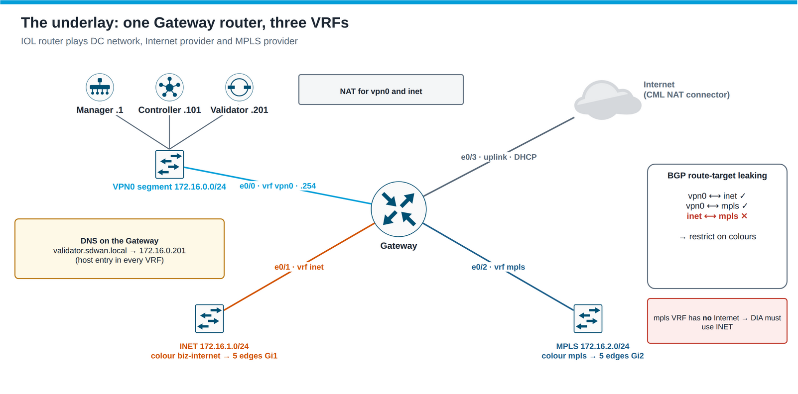
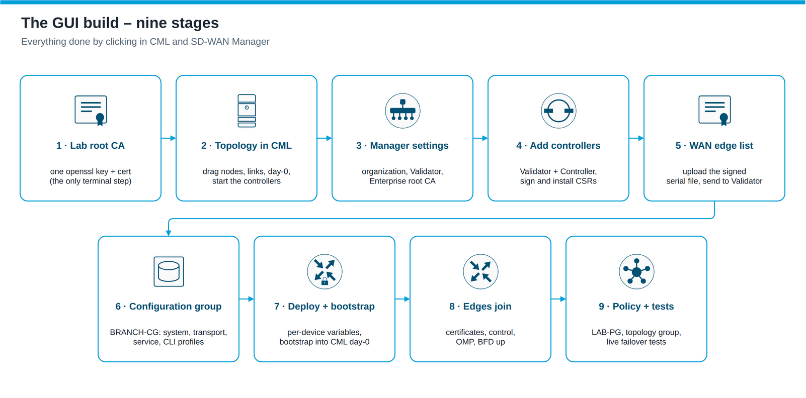
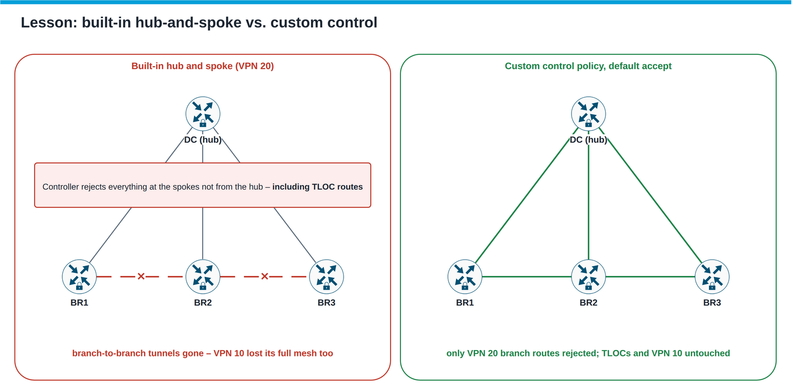
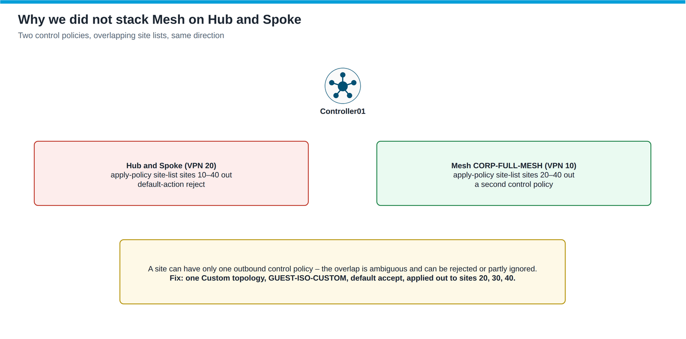
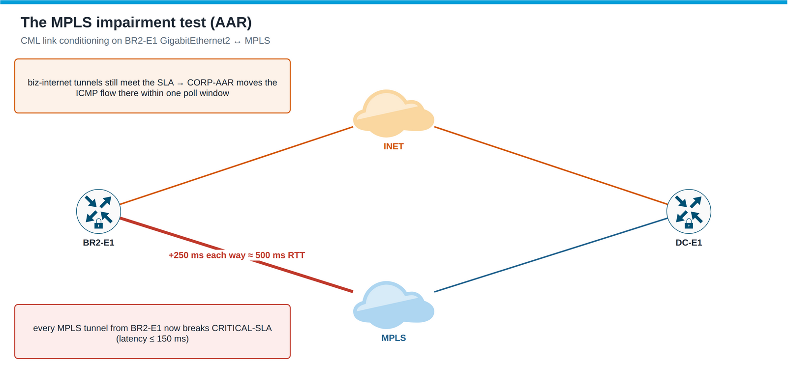

# Cisco Catalyst SD-WAN on CML – GUI build from A to Z

Companion folder for the video **Cisco Catalyst SD-WAN on CML – GUI Build A to Z**: https://youtu.be/Hnb5PvOhSkk

This is the same five-edge lab as [2026-11-21_2245_cisco-catalyst-sdwan-cml](../2026-11-21_2245_cisco-catalyst-sdwan-cml/), but this time it is built **by hand in the GUIs** (CML Workbench and SD-WAN Manager), starting from an empty CML canvas. The only things done outside a GUI are:

1. the lab root CA (a few `openssl` commands, see [`ca/`](ca/)), and
2. **one Manager API call** for the WAN Edge Cloud certificate authority (see [API exception](#the-one-api-exception)).

| Item | Value |
|---|---|
| CML | 2.10, one lab `sdwan-gui` |
| Controllers | SD-WAN Manager, Controller, Validator 20.18.2.1 |
| Edges | 5 × Catalyst 8000V 17.18.2, IOS XE SD-WAN (controller mode) |
| Organization | `cml-sdwan-lab-tool` |
| Validator | `validator.sdwan.local` (resolved by the Gateway), port 12346 |
| Transports | INET 172.16.1.0/24 colour `biz-internet` (Gi1), MPLS 172.16.2.0/24 colour `mpls` (Gi2), both `restrict` |
| Service VPNs | VPN 10 CORP (Gi3), VPN 20 GUEST (Gi4), VRRP on both |

## Topology and addressing



| Device | System IP | Site | MPLS / INET | VPN 10 (CORP) | VPN 20 (GUEST) | VRRP prio |
|---|---|---|---|---|---|---|
| Manager01 | 10.255.255.1 | 100 | 172.16.0.1 (VPN 0) | – | – | – |
| Controller01 | 10.255.255.2 | 100 | 172.16.0.101 | – | – | – |
| Validator01 | 10.255.255.3 | 100 | 172.16.0.201 | – | – | – |
| DC-E1 | 10.255.0.10 | 10 | .10 | 10.10.10.2, VIP .1 | 10.10.20.2, VIP .1 | 110 |
| BR1-E1 | 10.255.0.21 | 20 | .21 | 10.20.10.2, VIP .1 | 10.20.20.2, VIP .1 | 110 (master) |
| BR1-E2 | 10.255.0.22 | 20 | .22 | 10.20.10.3, VIP .1 | 10.20.20.3, VIP .1 | 100 (backup) |
| BR2-E1 | 10.255.0.30 | 30 | .30 | 10.30.10.2, VIP .1 | 10.30.20.2, VIP .1 | 110 |
| BR3-E1 | 10.255.0.40 | 40 | .40 | 10.40.10.2, VIP .1 | 10.40.20.2, VIP .1 | 110 |

Hosts (Alpine): DC-SRV 10.10.10.100, BR1-PC 10.20.10.100, BR1-GUEST 10.20.20.100, BR2-PC 10.30.10.100, BR2-GUEST 10.30.20.100, BR3-PC 10.40.10.100.

The IOL **Gateway** plays three roles with three VRFs (`vpn0`, `inet`, `mpls`). BGP route-target leaking joins `vpn0` to both providers but not `inet` to `mpls`, so the `restrict` keyword on each colour gives exactly two tunnels per router pair. The `mpls` VRF has no Internet, so guest DIA must leave over INET.

## The GUI build, step by step



1. **Clean start** – CML dashboard: stop, wipe and delete the old lab.
2. **Lab root CA** – `openssl` RSA 4096 key and a 10-year self-signed root (`O=cml-sdwan-lab-tool`). `ca/put-ca.py` places the root into the controllers' day-0 user data; `ca/sign.sh NAME` signs a CSR (730 days).
3. **Topology in CML** – drag the nodes (3 controllers, IOL Gateway, unmanaged switches, 5 SD-WAN edges, Alpine hosts), rename them, wire them, set day-0 configs (NAT connector for the Internet, System Bridge for management), start Gateway, switches and controllers. Edges stay off.
4. **Manager settings** (Administration → Settings) – organization name, Validator `validator.sdwan.local:12346`, Controller certificate authorization = **Enterprise Root Certificate** (manual) with the lab root PEM.
5. **Controllers** (Configuration → Devices → Control components → Add Controller and Validator) – Controller 172.16.0.101, Validator 172.16.0.201. Certificate management → generate CSRs for all three → sign with `sign.sh` → Install Certificate → **Send to Validator**.
6. **WAN edge list** – Devices → WAN Edge list → Quick Connect → upload the signed serial file, select five C8000v chassis.
7. **Configuration group `BRANCH-CG`**
   - System profile `LAB-SYSTEM`: `LAB-global`, `LAB-aaa`, `LAB-bfd` (**app-route poll interval 30000 ms, multiplier 2**), `LAB-omp` (graceful restart, ECMP 4), `LAB-basic` (America/Los_Angeles; system IP, site ID, host name as variables).
   - Transport profile `LAB-TRANSPORT`: `LAB-VPN0` (0.0.0.0/0 via 172.16.1.254 and 172.16.2.254), `LAB-VPN0-INET` (Gi1, tunnel `biz-internet restrict`, IPsec, NAT), `LAB-VPN0-MPLS` (Gi2, tunnel `mpls restrict`, IPsec).
   - Service profile `LAB-SERVICE`: `LAB-VPN10-CORP` with `LAB-VPN10-CORP-LAN` (Gi3, VRRP group 10), `LAB-VPN20-GUEST` with `LAB-VPN20-GUEST-LAN` (Gi4, VRRP group 20). Addresses, VIPs and `vrrp_priority` are variables.
   - CLI profile `LAB-CLI`: `platform console serial` (CML console).
   - **Gotcha:** every interface feature's *Shutdown* field defaulted to *shut* – set it to Global / off.
8. **Deploy** – associate the five edges, fill the per-device variables (table above), deploy (tasks end as *Done – Scheduled*), **Generate Bootstrap Configuration** (cloud-init) per edge and paste it into each edge's CML day-0 config.
9. **Edges join** – start the edges a couple at a time; fix the edge certificates (below); Monitor → Overview / Real Time → OMP Peers, OMP Received Routes.
10. **Policy group `LAB-PG`** with application priority `LAB-APP-PRIORITY` (Advanced Layout):
    - `CORP-AAR` (VPN `LAB-VPN10-CORP`): sequence `CRITICAL-OVER-MPLS` – match protocol 1 + `CORP-NETS` → counter `CORP-CRITICAL`, SLA class `CRITICAL-SLA` (loss 2 %, latency 150 ms, jitter 50 ms), preferred colour `mpls`, fallback to best path.
    - `GUEST-DIA` (VPN `LAB-VPN20-GUEST`): `PRIVATE-STAYS-IN-OVERLAY` (RFC 1918 → accept) and `INTERNET-LOCAL-EXIT` (source `GUEST-NETS` → NAT use VPN 0, fallback). The GUI numbered them 1 and 11.
11. **Topology group `LAB-TOPOLOGY-GROUP`** with one Custom topology `GUEST-ISO-CUSTOM` (default accept, outbound to sites 20, 30, 40): `GUEST-FROM-HUB` (site 10 + VPN 20 → accept), `GUEST-OTHER-REJECT` (VPN 20 → reject).

The resulting controller policy is in [`configs/Controller01.running.txt`](configs/Controller01.running.txt); edge configs in [`configs/`](configs/) (passwords and keys removed).

## The one API exception

For virtual edges, Manager must sign the edge certificates itself (*WAN Edge Cloud certificate authorization* = Manager). In 20.18.2.1 the GUI offered *Cisco PKI* / *Enterprise* only and our choice did not persist, so the edges stayed in CSR state. One call fixed it:

```bash
curl -sk -b cookies -H "X-XSRF-TOKEN: $TOKEN" -H "Content-Type: application/json" \
  -X POST https://<manager>/dataservice/settings/configuration/vedgecloud \
  -d '{"certificateauthority":"vmanage"}'
# read back
curl -sk -b cookies -H "X-XSRF-TOKEN: $TOKEN" https://<manager>/dataservice/settings/configuration/vedgecloud
```

Then, in the GUI: Configuration → Certificates → WAN Edge list → *Actions → Renew Device CSR* on each edge. Manager signed and installed each certificate within seconds.

## Lessons learned (the real problems we hit)

- **Organization name** must be identical in the certificates, Manager settings and the serial file.
- **Interface Shutdown default** in configuration-group interface features was *shut*.
- **WAN Edge Cloud CA** for virtual edges = Manager (API call above), then *Renew Device CSR*.
- **Application priority, simple layout** has default action *Drop* – use the Advanced Layout.
- The traffic-policy **VPN field takes the service VPN parcel name** (`LAB-VPN10-CORP`), not the VPN number.
- The policy-group deployment includes **Controller01** (centralized data policy is pushed via the Controller).
- **Built-in Hub and Spoke** generated `default-action reject` outbound to the spokes – it would have rejected TLOC routes and VPN 10, removing branch-to-branch tunnels.
- Adding a **Mesh** for VPN 10 next to it produced two outbound control policies on overlapping site lists (10–40 and 20–40). Replace both with **one Custom topology, default accept**.




## Test results (recorded in the video, GUI only)

| Test | How | Result |
|---|---|---|
| Guest isolation | BR2-GUEST → BR1-GUEST 10.20.20.100 | 100 % loss (intended) |
| DC guest reachability | BR2-GUEST → 10.10.20.1 | OK |
| Guest DIA | BR2-GUEST → 8.8.8.8 | OK, via BR2's own INET link |
| CORP full mesh | BR2-PC → DC-SRV, BR3-PC | OK (first packet lost to ARP) |
| Verify | Manager → BR2-E1 → Real Time → OMP Received Routes, VPN 20 | only 10.10.20.0/24 + own guest LAN |
| AAR | CML link conditioning +250 ms on BR2-E1 Gi2 ↔ MPLS; continuous ping BR2-PC → DC-SRV | ~4 ms → ~505 ms (on MPLS) → back to ~4 ms within ~30 s (moved to biz-internet); App Route Statistics: MPLS mean latency 498 ms; 336/337 replies |
| VRRP failover | Stop BR1-E1 in CML; ping BR1-PC → DC-SRV | 4 of 85 lost; BR1-E2 master (10.20.10.3); BFD 6/8 |
| VRRP pre-empt | Start BR1-E1 again | rejoined after ~5.5 min, master again, 360/360 replies |



## Folder contents

| Path | What |
|---|---|
| `ca/put-ca.py`, `ca/sign.sh` | Lab root CA helpers (create the root with the `openssl` commands shown in the video) |
| `configs/` | Controller01, BR1-E1, BR2-E1 running configs after the build (secrets removed) |
| `diagrams/src/*.drawio`, `diagrams/png/*.png` | All draw.io diagrams used in the lesson (final build stage of each) |
| `diagrams/gen.py`, `diagrams/dlib.py` | Generator for the new diagrams (`steps`, `fail`, `ovl`); the others come from the generator in the 2026-11-21 folder |
| `tools/vcli.py` | Read-only show commands on controllers via the Manager CLI hop |
