# Cisco Catalyst 9800 Wireless on CML – controller, APs and clients from A to Z

Companion folder for the video **Cisco Catalyst 9800 Wireless on CML – A to Z**: https://youtu.be/fDaEXQ1p3sY

A Catalyst 9800-CL wireless controller, two CML virtual access points and two simulated Wi-Fi clients, built from an empty CML canvas. The controller is brought up on the CLI (management address, certificate, CRL, country code), then everything wireless is done in the **9800 WebUI**: the day-0 wizard, VLANs, the trunk, policy profiles, a policy tag and AP tag assignment. Tests: a CORP client, a GUEST client blocked from internal networks, the client in Monitoring, and an AP failure.

| Item | Value |
|---|---|
| CML | 2.10, one lab `cat9800-wireless` |
| Controller | Catalyst 9800-CL 17.18.3, **4 vCPU / 8 GB** (local mode) |
| APs | 2 × CML wireless AP (CAPWAP, beta) on SW1 e0/1 and e0/2, VLAN 100 |
| Clients | 2 × CML wireless client (Linux + wpa_supplicant, beta) |
| Wired | IOL L3 switch SW1 (gateways, DHCP, guest ACL), IOL router R1 (NAT), Alpine SRV1 |
| SSIDs | CORP (WPA2-PSK) → CORP-POLICY → VLAN 20; GUEST (WPA2-PSK) → GUEST-POLICY → VLAN 30 |
| Management | WLC Gi2 / Vlan99 192.168.122.60 (CML System Bridge); wireless management Vlan100 10.10.100.254 |

## Topology

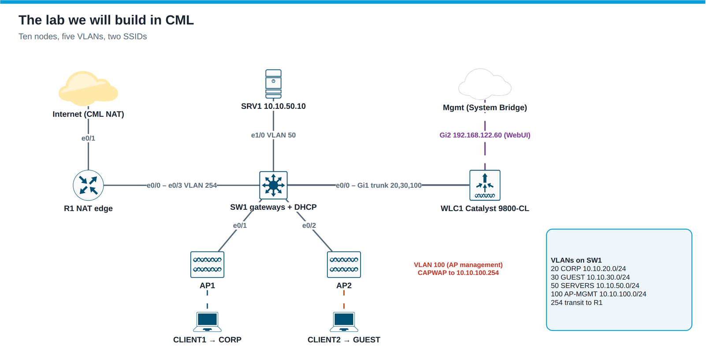

| VLAN | Name | Subnet | Gateway (SW1) | Notes |
|---|---|---|---|---|
| 20 | CORP | 10.10.20.0/24 | 10.10.20.1 | DHCP pool CORP |
| 30 | GUEST | 10.10.30.0/24 | 10.10.30.1 | DHCP pool GUEST, ACL `GUEST-IN` (deny 10/8, 172.16/12, 192.168/16) |
| 50 | SERVERS | 10.10.50.0/24 | 10.10.50.1 | SRV1 10.10.50.10 |
| 100 | AP-MGMT | 10.10.100.0/24 | 10.10.100.1 | DHCP pool AP-MGMT, option 43 `f104.0a0a.64fe` = WLC 10.10.100.254 |
| 254 | TRANSIT | to R1 e0/0 | – | R1 NATs out e0/1 |

SW1 e0/0 ↔ WLC Gi1 is a trunk allowing **20,30,100**.

## Concepts (diagrams)

| | |
|---|---|
| 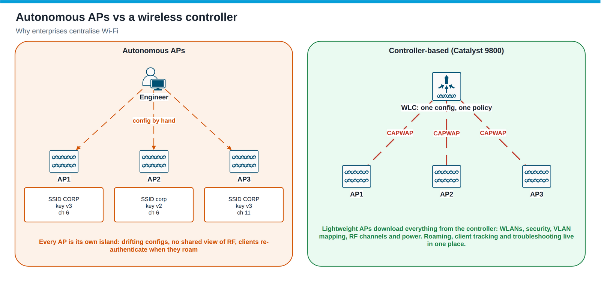 | 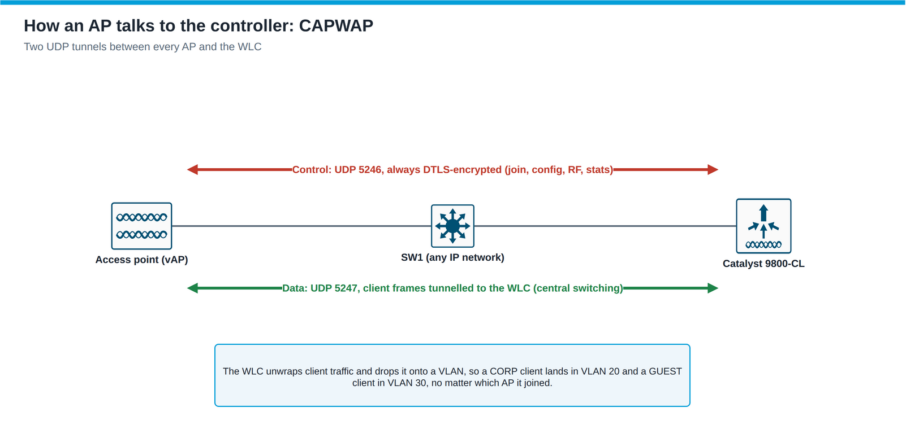 |
| 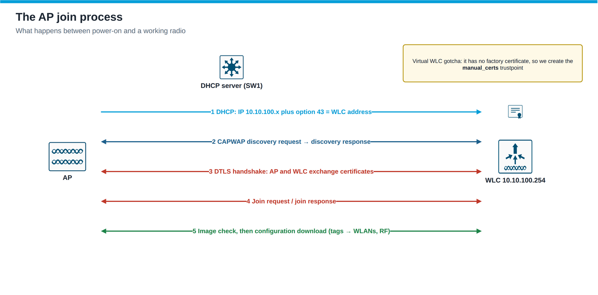 | 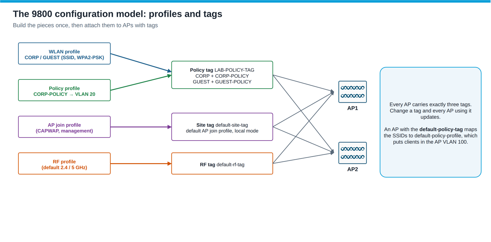 |
| 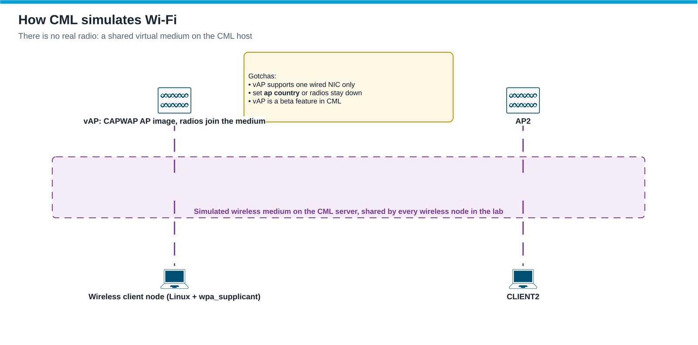 | 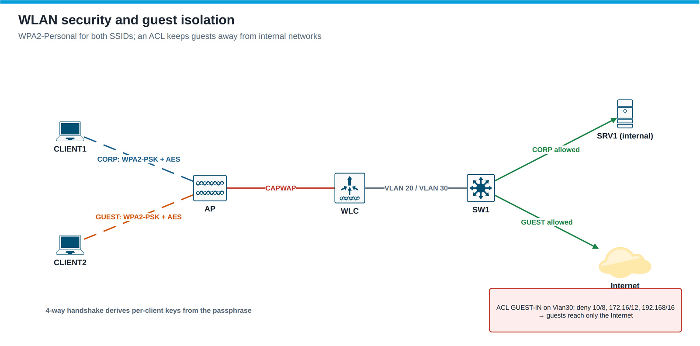 |

All diagrams are draw.io files with Cisco stencils in [`diagrams/drawio`](diagrams/drawio); [`tools/gen.py`](tools/gen.py) regenerates them (each in build-up stages) and renders PNGs with the draw.io desktop CLI.

## The build, step by step

1. **CML** – delete the old lab, create `cat9800-wireless`, drag in the nodes, set WLC1 to 4 vCPU / 8192 MB, paste the day-0 configs from [`configs/`](configs/), add the links (SW1 e0/3 ↔ R1 e0/0), external connectors NAT (R1 e0/1) and System Bridge (WLC Gi2), start.
2. **Controller CLI**
   - Vlan99 had no address after boot: `interface Vlan99` / `ip address 192.168.122.60 255.255.255.0`.
   - AP certificate (a 9800-CL has no factory certificate): `crypto pki import manual_certs pem url bootflash:manual_certs/manual_certs password cisco123` (PEM bundle on bootflash), then `wireless management trustpoint manual_certs`.
3. **Day-0 WebUI wizard** (https://192.168.122.60)
   - General: standalone, WLC1, country US, wireless management Gi1 VLAN 100, 10.10.100.254/24, static route 0.0.0.0/0 → 10.10.100.1.
   - Wireless networks: CORP (Employee, WPA2 Personal). GUEST built as **Employee + WPA2 Personal**, because the Guest type forces web auth and a RADIUS server.
   - Advanced: AP management user `apadmin`; Generate Certificate **off** (we use `manual_certs`).
4. **Controller CLI again**
   - DTLS join failed on the revocation check: `crypto pki trustpoint manual_certs` / `revocation-check none` (lab only).
   - Country code: `ap dot11 24ghz shutdown`, `ap dot11 5ghz shutdown`, `ap dot11 6ghz shutdown`, `ap country US`, then `no shutdown` on all three, `write memory`.
5. **WebUI configuration**
   - Configuration › Layer2 › VLAN: 20 CORP, 30 GUEST.
   - Gi1 trunk allowed VLANs **20,30,100** (the wizard set 100 only).
   - Tags & Profiles › Policy: `CORP-POLICY` (VLAN 20), `GUEST-POLICY` (VLAN 30), central switching.
   - Tags › Policy: `LAB-POLICY-TAG` = CORP→CORP-POLICY, GUEST→GUEST-POLICY.
   - AP › each AP: policy tag `LAB-POLICY-TAG` (site tag `default-site-tag`, RF tag `default-rf-tag`). The APs rejoin.
6. **CORP client** – CLIENT1: `wpa_supplicant -B -i wlan0 -c /etc/wpa_supplicant/lab.conf`, `dhcpcd wlan0`.

## Gotchas

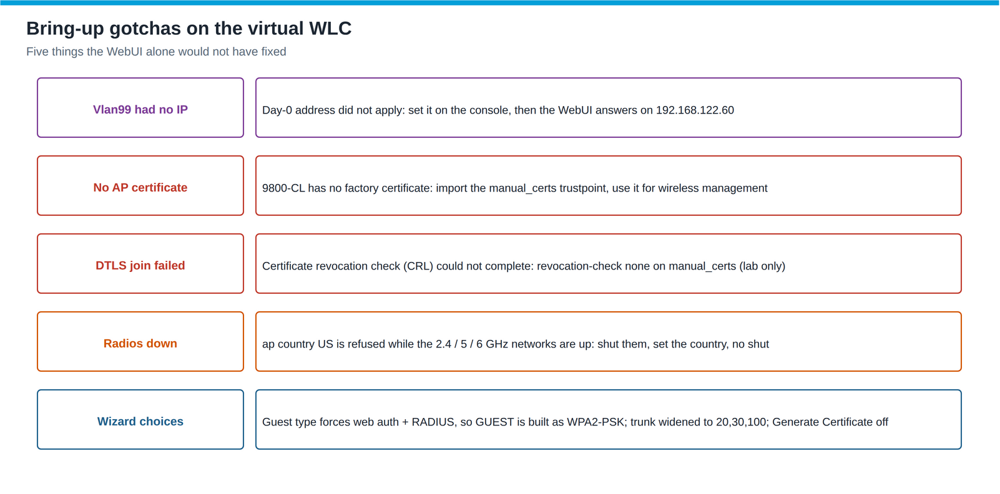

- **Switch VLAN database.** DHCP for CORP failed (client stuck in *IP Learn*). On SW1, Vlan20/Vlan30 were down and the trunk forwarded only VLAN 100: VLANs 20 and 30 were not in the VLAN database although the day-0 config had `vlan` lines. Creating them by hand fixed it. [`configs/SW1.txt`](configs/SW1.txt) now includes `vtp mode transparent` so the VLANs are kept in the running config.
- **ap country** is refused while the 2.4/5/6 GHz networks are enabled.
- **Generate Certificate** in the wizard is not needed when you import your own trustpoint.

## Troubleshooting CLIENT2 (GUEST)

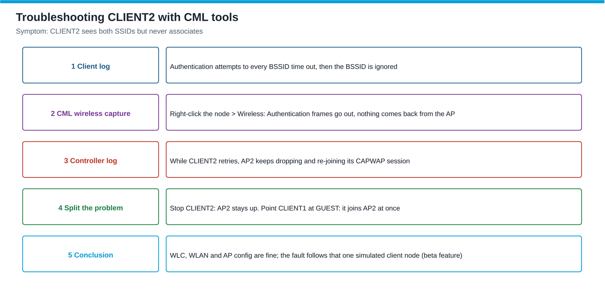

CLIENT2 saw both SSIDs but never associated. The client log showed authentication timeouts and ignored BSSIDs; a temporary single-SSID tag on AP2 changed nothing; a **CML wireless packet capture** (right-click the node › Wireless) showed authentication frames with no AP response; a wipe and restart did not help. The controller log showed AP2 dropping and re-joining CAPWAP every ~25 s while CLIENT2 retried, and AP2 stayed stable once CLIENT2's supplicant was stopped. CLIENT1 pointed at GUEST joined AP2 immediately. Conclusion: WLC/WLAN/AP config is fine, and the fault follows that one simulated client node (the wireless nodes are beta).

## Tests

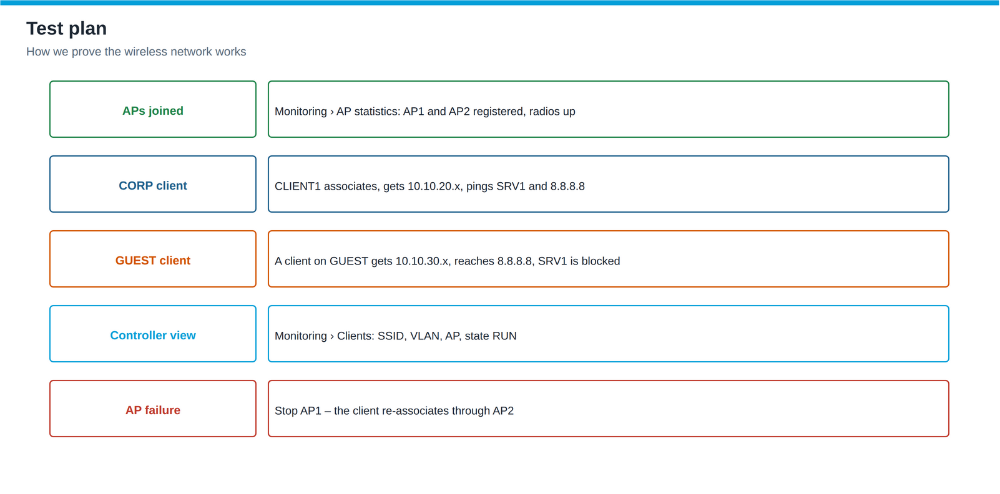

| Test | Result |
|---|---|
| APs joined | AP1 and AP2 registered, radios up after `ap country US` |
| CORP | CLIENT1 10.10.20.101; 10.10.20.1, SRV1 10.10.50.10 and 8.8.8.8 reachable |
| GUEST | CLIENT1 on GUEST via AP2: 10.10.30.101; 8.8.8.8 OK; SRV1 → *Packet filtered* from 10.10.30.1 (ACL GUEST-IN) |
| AP failure | AP1 stopped. The simulated client does not detect beacon loss, so `wpa_cli scan` + `wpa_cli reassociate` moved it to AP2 on CORP; same IP 10.10.20.101; SRV1 and 8.8.8.8 reachable again |
| Controller view | Monitoring › Clients: 10.10.20.101, AP2, CORP, Run, 11n (5 GHz), policy profile CORP-POLICY, mobility history |

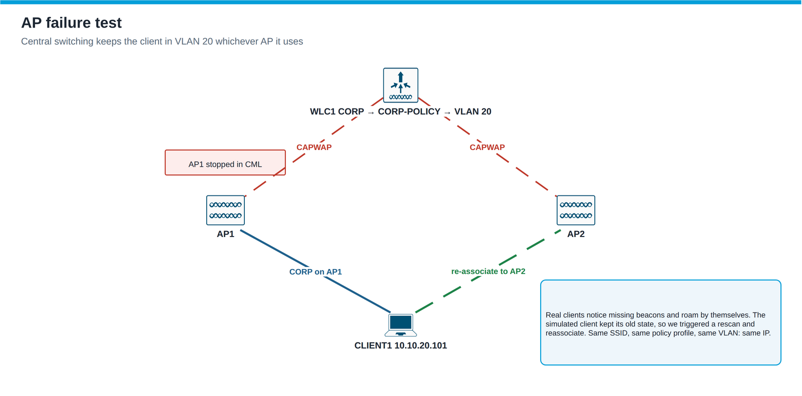

## Lessons learned

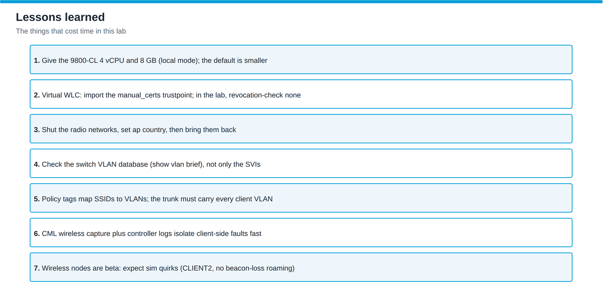

## Files

| Path | Content |
|---|---|
| `configs/WLC1-day0.txt` | WLC1 day-0: management access only |
| `configs/WLC1-final-running-config.txt` | WLC1 running config at the end of the lesson (hashes removed) |
| `configs/SW1.txt`, `R1.txt`, `SRV1.txt` | Wired side day-0 configs |
| `configs/CLIENT1.txt`, `CLIENT2.txt` | Wireless client cloud-config with the wpa_supplicant profile (CORP / GUEST) |
| `diagrams/` | draw.io sources and PNGs |
| `tools/gen.py`, `tools/dlib.py` | Diagram generator |

`<ADMIN_PASSWORD>` is a placeholder; set your own. The PSKs `CorpLab2026` / `GuestLab2026` and the `cisco/cisco` logins are lab-only values.

## References

- Cisco Modeling Labs – Catalyst 9800-CL node (resource profiles, local mode needs 4 vCPU / 8 GB): https://developer.cisco.com/docs/modeling-labs/catalyst-9800-cl/
- Cisco Modeling Labs FAQ (wireless AP and client images, beta): https://developer.cisco.com/docs/modeling-labs/faq/
- Cisco Modeling Labs release notes: https://developer.cisco.com/docs/modeling-labs/cml-release-notes/
- Catalyst 9800 configuration model, recommendations and limitations: https://www.cisco.com/c/en/us/td/docs/wireless/controller/9800/config-guide/New-Configuration-Model/b_catalyst-9800-configuration-model/m_recommendations-and-limitations.html
- Cisco Spaces Connector – configuring the Catalyst 9800: https://www.cisco.com/c/en/us/td/docs/wireless/spaces/connector/2-x/config/b_connector/m_ewlc_9800.html
- PingLabz – Catalyst 9800-CL in CML, limitations: https://www.pinglabz.com/catalyst-9800-cl-cml-limitations/
