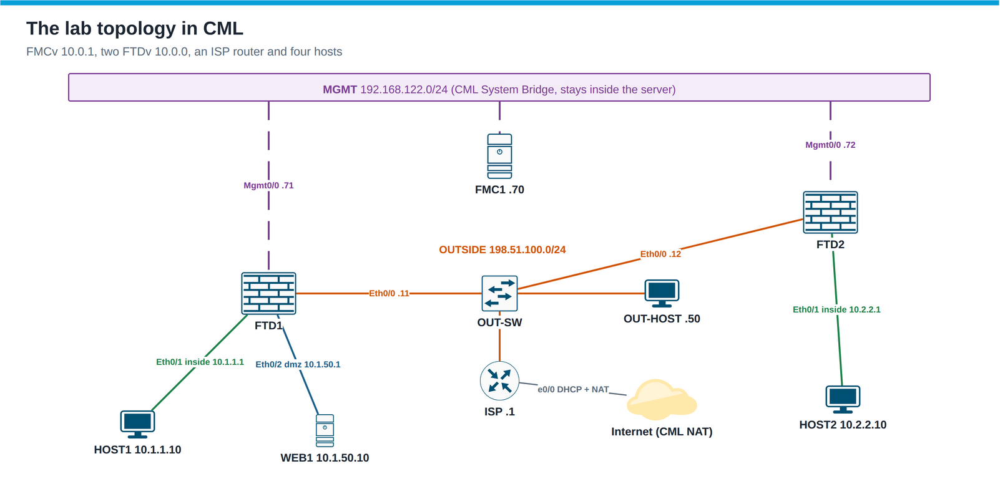
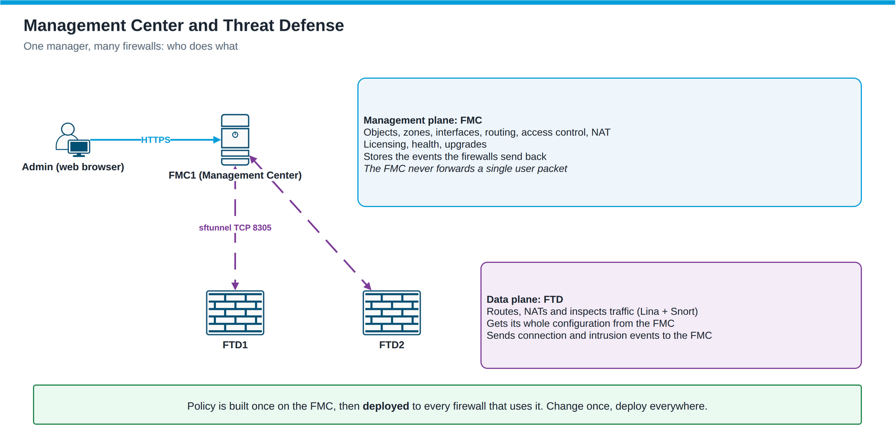
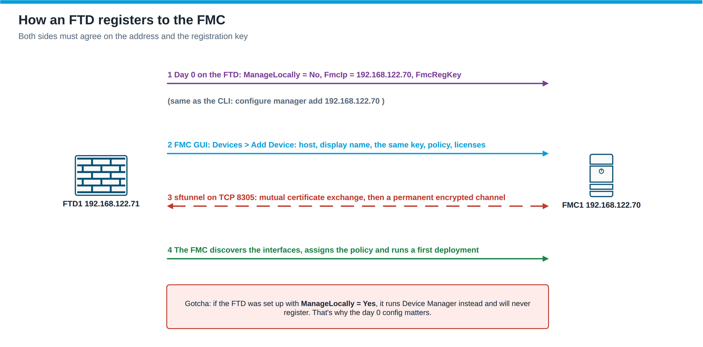
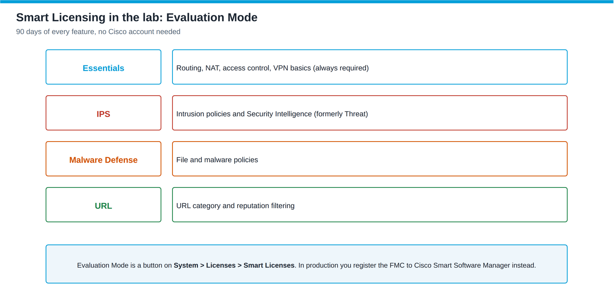
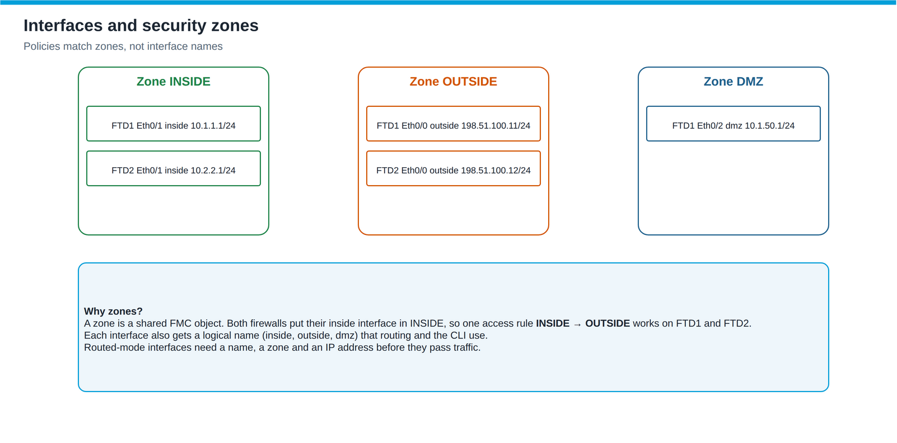
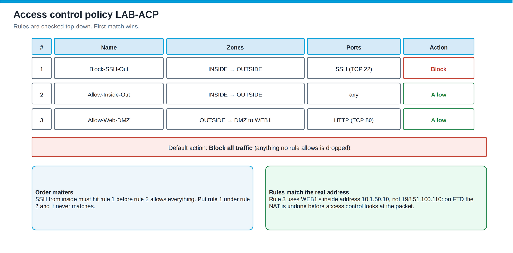
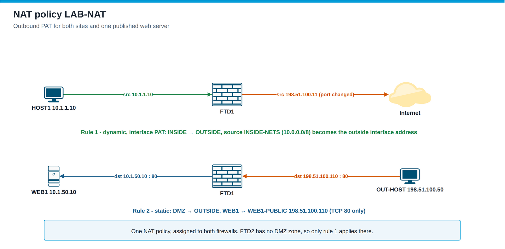
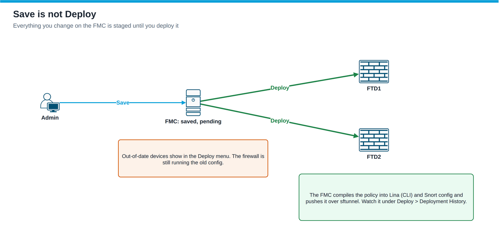
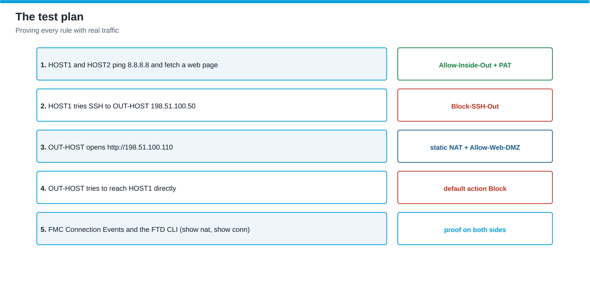

# Cisco FTD through FMC on CML – two firewalls built from scratch in the FMC GUI

Companion folder for the video **Cisco FTD through FMC on CML – GUI Build A to Z**: https://youtu.be/PZqxwVtRMm0

A Firewall Management Center (FMCv) and two Firewall Threat Defense virtual firewalls (FTDv), built from an empty CML canvas. Day-0 files only set management (address, password, FMC address, registration key). Everything else is done by hand in the **FMC GUI**: evaluation licensing, objects, security zones, an access control policy, device registration, interfaces, static routes, a NAT policy and the deployment. The tests prove each rule from the hosts, the FTD CLI and the FMC Unified Events.

| Item | Value |
|---|---|
| CML | one lab `fmc-ftd-gui` ([`fmc-ftd-gui.yaml`](fmc-ftd-gui.yaml), passwords replaced by placeholders) |
| FMC | FMCv 10.0, FMC1, 192.168.122.70 |
| Firewalls | 2 × FTDv 10.0 (routed), FTD1 192.168.122.71, FTD2 192.168.122.72, FTDv20 tier, Essentials |
| Management | CML **System Bridge** 192.168.122.0/24 through the unmanaged switch MGMT-SW (stays inside the CML server) |
| Outside | 198.51.100.0/24 on OUT-SW: ISP router .1 (NAT to the Internet), FTD1 .11, FTD2 .12, OUT-HOST .50 |
| Inside | HOST1 10.1.1.10 behind FTD1 (10.1.1.1), HOST2 10.2.2.10 behind FTD2 (10.2.2.1) |
| DMZ | WEB1 10.1.50.10 behind FTD1 (10.1.50.1), published as **198.51.100.110** |
| Licensing | 90-day evaluation (no Smart account) |

## Topology

CML labels the FTDv data ports `GigabitEthernet0/0-0/2`; inside the FTD and in the FMC they appear as **Ethernet0/0-0/2**.

| FTD | Interface | Name | Zone | Address |
|---|---|---|---|---|
| FTD1 | Ethernet0/0 | outside | OUTSIDE | 198.51.100.11/24 |
| FTD1 | Ethernet0/1 | inside | INSIDE | 10.1.1.1/24 |
| FTD1 | Ethernet0/2 | dmz | DMZ | 10.1.50.1/24 |
| FTD2 | Ethernet0/0 | outside | OUTSIDE | 198.51.100.12/24 |
| FTD2 | Ethernet0/1 | inside | INSIDE | 10.2.2.1/24 |

Both FTDs: static route `any-ipv4` via `outside` to host object **ISP-GW** 198.51.100.1.

## Concepts (diagrams)

| | |
|---|---|
|  |  |
|  |  |
|  |  |
|  |  |

All diagrams are draw.io files with Cisco stencils in [`diagrams/drawio`](diagrams/drawio); [`tools/gen.py`](tools/gen.py) regenerates them (each in build-up stages) and renders PNGs with the draw.io desktop CLI.

## The build, step by step

1. **CML** – create `fmc-ftd-gui`; add FMCv, 2 × FTDv, MGMT-SW and OUT-SW (unmanaged switches), an IOL router (ISP), Alpine hosts (HOST1, HOST2, OUT-HOST), a web server (WEB1), and two external connectors: **System Bridge** (management) and **NAT** (Internet). Paste the day-0 files from [`configs/`](configs/), wire it as in the topology, start. The FMCv first boot takes more than 30 minutes; an HTTP 503 at the login page means its services are still starting.
   - FTD day-0 essentials: `"FirewallMode": "routed"`, `"ManageLocally": "No"`, `"FmcIp": "192.168.122.70"`, `"FmcRegKey": "<REGISTRATION_KEY>"`. With `ManageLocally: Yes` the FTD runs Device Manager and never registers to the FMC.
2. **Licensing** – first login opens *Configure Smart Licensing*: **Start 90-day evaluation period without registration**.
3. **Objects › Network** – `INSIDE-NETS` 10.0.0.0/8, `WEB1` 10.1.50.10, `WEB1-PUBLIC` 198.51.100.110.
4. **Objects › Interface** – routed security zones `INSIDE`, `OUTSIDE`, `DMZ`.
5. **Policies › Access Control** – `LAB-ACP`, default action **Block all traffic**:

   | # | Name | Zones | Networks / ports | Action |
   |---|---|---|---|---|
   | 1 | Block-SSH-Out | INSIDE → OUTSIDE | dst port SSH | Block |
   | 2 | Allow-Inside-Out | INSIDE → OUTSIDE | any | Allow |
   | 3 | Allow-Web-DMZ | OUTSIDE → DMZ | dst WEB1 (real address), HTTP | Allow |

6. **Devices › Device Management › Add › Device** – registration key method, host 192.168.122.71 / .72, display name FTD1 / FTD2, the registration key, policy `LAB-ACP`, virtual device, FTDv20 tier, Essentials.
7. **Interfaces** – as in the table above (name + zone + address, or the interface passes nothing). **Routing › Static Route** – `outside`, `any-ipv4`, gateway `ISP-GW` (created with the **+** next to the gateway field on FTD1, picked from the list on FTD2).
8. **Devices › NAT** – Threat Defense NAT policy `LAB-NAT`, targets FTD1 and FTD2:
   - Rule 1: manual, **dynamic**, INSIDE → OUTSIDE, source `INSIDE-NETS` → *Destination Interface IP* (PAT).
   - Rule 2: manual, **static**, DMZ → OUTSIDE, `WEB1` → `WEB1-PUBLIC`, original and translated source port `HTTP`.
   - FTD2 has no DMZ, so only rule 1 is pushed to it.
9. **Deploy › Deploy All** – the validation warning *"The changes to Virtual Routers may cause traffic disruption"* is expected on a first deployment (Ignore warnings). Check **Deployment History**. Until the first deployment the device list shows the access control policy as *None*.

## Tests

| Test | Expected | Result |
|---|---|---|
| HOST1 / HOST2 `ping 8.8.8.8`, `wget http://example.com` | allowed, PAT to .11 / .12 | ✅ |
| HOST1 `ssh 198.51.100.50` (OUT-HOST runs sshd) | Block-SSH-Out | ✅ timed out |
| OUT-HOST `wget http://198.51.100.110` | static NAT + Allow-Web-DMZ | ✅ WEB1 page |
| OUT-HOST `ping 10.1.1.10` | default action Block | ✅ 100 % loss |
| FTD1 `show running-config nat`, `show nat`, `show xlate` | both rules with hits, WEB1 ↔ 198.51.100.110 | ✅ |
| FTD2 `show running-config nat` | PAT rule only | ✅ |
| FMC › Events & Logs › Unified Events | Allow / Block events with rule names; inbound web shows the real address 10.1.50.10 | ✅ |

HOST1 cannot reach 198.51.100.110 (no NAT hairpin on FTD1), which is expected; HOST2 can, through FTD2 and the outside segment.

## Tools

- [`tools/lab.sh`](tools/lab.sh) – log in to an Alpine node console through the CML terminal server and run commands (wraps a small `con.py` console client that is not included).
- [`tools/ftd.exp`](tools/ftd.exp) – SSH to an FTD management IP and run CLISH `show` commands (password read from `~/.ftdpw`). The first command after login can take a minute to answer.

## Lessons learned

1. Day 0 decides the manager: `ManageLocally: No`, plus `FmcIp` and the registration key.
2. Keep management on an isolated network (CML System Bridge), never bridged to the home LAN.
3. The FMCv needs plenty of memory and a long first boot; register the FTDs only once it's up.
4. Zones are shared objects: name them once, reuse them on every firewall.
5. Access rules are top-down, first match wins: blocks above broad allows.
6. Access rules match real (untranslated) addresses.
7. Nothing changes on a firewall until you deploy.
