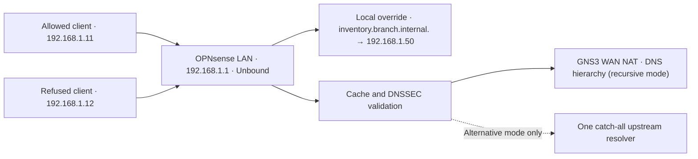

# Branch-office DNS with Unbound on OPNsense

Branch users need both local inventory application name resolution and normal
public DNS. A firewall policy controls which packets reach the resolver; an
Unbound access list controls which source addresses Unbound will serve. A host
override gives the inventory application a stable private name. DNSSEC protects
validated public answers against forged or modified records; it does not encrypt
the DNS exchange. Caching avoids repeating upstream work until a record expires.

This guide uses only an isolated GNS3 project. It does not configure your host,
production firewall, DHCP, or DNS settings. Do not bridge this lab to a shared
or corporate LAN. Do not run a resolver on WAN. These files do not provision
a VM or change the firewall.

## Design



The private inventory address represents an application, not necessarily a
running HTTP server. An A/PTR answer proves DNS mapping, not reachability or
application health. The example addresses are for the lab; adapt them if they
overlap a network on your computer. Use isolated client nodes, or separate
network namespaces with distinct source addresses. The server in the script is
always explicit so the host's system resolver is not changed.

## What you need

- A working GNS3 installation with a QEMU-capable GNS3 server, an official
  OPNsense appliance for that server, a NAT node, an Ethernet switch, and a
  Linux client with a browser or a separately connected lab management client.
  Download OPNsense from [its official download page](https://opnsense.org/download/)
  and check the release checksum before importing it under the GNS3 QEMU
  appliance settings. Consult [GNS3 documentation](https://docs.gns3.com/) for
  installation and the [GNS3 NAT node guide](https://docs.gns3.com/docs/using-gns3/advanced/the-nat-node/)
  for scope and prerequisites.
- Give the appliance two virtual NICs. Connect WAN to GNS3 NAT, LAN to the
  private virtual switch, and the two private test clients to that switch.
  Assign the two NICs at first boot if needed, then use the OPNsense Web GUI
  for service configuration. Set WAN to DHCP from GNS3 NAT and LAN to
  `192.168.1.1/24`. Give clients `192.168.1.11/24` and
  `192.168.1.12/24`, each with gateway `192.168.1.1` when testing internet
  traffic. Keep LAN management access limited to the lab.
- On a Debian/Ubuntu test client, `sudo apt update` refreshes package metadata
  and `sudo apt install dnsutils` installs `dig`. On Fedora, the equivalent
  package is `bind-utils`. If running packet capture on the Linux client,
  install `tcpdump` or Wireshark there; OPNsense also has a Web GUI capture
  tool. Install packages in the test client, not on the firewall or host.
- Open the firewall Web GUI from the lab management client at
  `https://192.168.1.1/`. Trust only the intended lab certificate; do not
  transmit credentials over HTTP. Do not commit certificates, credential files,
  firewall exports or unsanitized packet captures.

## Configure in the OPNsense Web GUI

1. **Services → Unbound DNS → General**: enable Unbound; select LAN for
   client DNS service (and Loopback if needed for firewall-local queries);
   do not expose it on WAN. Use the standard DNS listener port 53. Enable
   DNSSEC validation. Keep outgoing interface selection appropriate for
   routed WAN access; listening interface selection and outbound interface
   selection are different settings.
2. **Services → Unbound DNS → Overrides**: add a host override with Host
   `inventory`, Domain `branch.internal`, Type `A`, IP `192.168.1.50`, and
   an explanatory description. Save and **Apply**. OPNsense generates a PTR
   for a non-wildcard host override; confirm it with a reverse DNS lookup.
3. **Services → Unbound DNS → Access Lists**: check that LAN clients are
   permitted and add a more-specific host ACL, named `Refuse_test_client`, using action **Refuse**, network
   `192.168.1.12/32`. Save and **Apply**. The intent is to return DNS
   `REFUSED` to this source, not silently drop packets. A lab LAN firewall rule
   must allow DNS from both test clients to the firewall itself for this
   comparison; if the second client instead times out, check that rule,
   source address, listener and packet path before blaming the ACL.
4. **Services → Unbound DNS → Query Forwarding**: disable
   **Use System Nameservers** and leave no catch-all active for the recursive
   baseline. Check that any **DNS-over-TLS** page entries do not override the
   intended baseline. Allow the lab resolver's outbound UDP and TCP destination
   port 53. In recursive mode, the resolver discovers authoritative servers
   by following referrals itself rather than using one recursive forwarder.

## Test from the clients

From the permitted client:

```sh
RESOLVER=192.168.1.1
dig -r @"$RESOLVER" inventory.branch.internal. A +noall +comments +answer
dig -r @"$RESOLVER" -x 192.168.1.50 +noall +comments +answer
dig -r @"$RESOLVER" missing-name.invalid. A +noall +comments +answer
```

- `-r` ignores user defaults in `~/.digrc`. `@RESOLVER` selects the lab
  server. A trailing dot makes the name absolute. `A` requests an IPv4
  address. `-x` constructs a reverse lookup. `+noall +comments +answer`
  shows the header (including status and flags) and answer records.
- The inventory query should show `NOERROR` and A `192.168.1.50`; reverse
  lookup should show a PTR to `inventory.branch.internal.`.
  `NXDOMAIN` means the queried name does not exist. It is not the same as
  `NOERROR` with no records of the requested type, and is not proof that the
  resolver answered locally unless a capture also shows no outgoing request.
- Run the A query from the refused node using `+time=4 +tries=1` to bound the
  wait. Do not use a source address you haven't assigned. Compare
  `REFUSED` against `NOERROR` from the allowed client.

For the repeatable six-check suite, pass the resolver and fixture names.
Use the lab resolver you operate. Here are the exact names used in the
recorded run. `missing-name.invalid.` is a reserved negative-test name;
its result does not prove that an unconfigured name under your private
zone would be answered locally.

```sh
./verify-unbound.sh --resolver 192.168.1.1 \
  --local-host inventory.branch.internal. --local-ip 192.168.1.50 \
  --missing missing-name.invalid. \
  --public www.iana.org. --signed cloudflare.com. \
  --bogus dnssec-failed.org. --check-cd
```

`+dnssec` asks for DNSSEC data; when the resolver has validated the signed
name, the header's `ad` bit signals authenticated data. A deliberately bogus
signed record should produce `SERVFAIL`. By itself, `SERVFAIL` is not
proof of DNSSEC enforcement: a broken upstream or incorrect system clock can
also produce it. A paired good result with `ad` strengthens the test.
The optional CD (checking disabled) query is a diagnostic, not a pass
criterion, because an upstream validator may still withhold a bogus answer.
Do not disable DNSSEC globally for this test. The script returns 0 if all six
required checks pass, 1 if a required check fails, or 2 for invalid usage or
a missing dependency.

## Prove caching and forwarding with packets

1. **Interfaces → Diagnostics → Packet Capture**: capture both LAN and WAN,
   with port 53 and a small time window. Leave protocol unrestricted so
   you don't miss TCP retries or fallbacks. Filter the resulting capture
   to the exact query name/query type where possible.
2. Pick a known public A name absent from this resolver's cache, or restart
   the resolver only in the disposable lab before testing. Query it twice from
   the same allowed client, keeping name, query type and options identical.
   Use `dig -r @"$RESOLVER" "$CACHE_TEST_NAME" A +noall +comments +answer +stats`
   for both queries; `+stats` includes query time. Look for a query/answer on
   LAN twice and the corresponding upstream exchange on WAN on the first
   lookup but not on the second. The two queries must be close enough to
   occur within the cached answer's TTL. Background traffic, prefetch,
   expiration, a capture filter error, or QNAME minimization can complicate
   interpretation. Timing and lower TTL alone do not prove cache use.
3. Optional contrast after a recorded baseline: add a catch-all under
   **Query Forwarding** using a blank **Domain**, upstream `1.1.1.1`, port 53.
   Keep **Use System Nameservers** off and apply. This is ordinary DNS, not
   DNS-over-TLS. Repeat with a cold name and show the WAN request destination
   is that upstream resolver. Do not infer forward mode from a valid answer
   alone; verify destination on WAN. Restore the no-forward baseline and
   stop captures after the lab.

## Optional: standalone loopback sample

This separate illustrative sample was not parsed or run during the live
lab. It is not a configuration file for OPNsense. Copy `unbound-loopback.conf.example`
to a local lab file, replace the anchor path placeholder with an absolute path
to the lab distro's **existing, readable static root trust-anchor file**, and
verify ownership/permissions before running. Use a dedicated copy of the
anchor, not a change to the system's config. The static anchor must be kept
up to date separately; the sample will not refresh it. For a long-lived
resolver, follow your distro's documented root-anchor management. No public
listener is configured; outbound queries still need WAN if you run it.

```sh
unbound-checkconf ./unbound-loopback.conf
unbound -d -c "$(pwd)/unbound-loopback.conf"
# In another terminal:
dig -r @127.0.0.1 -p 1053 inventory.branch.internal. A
dig -r @127.0.0.1 -p 1053 -x 192.168.1.50
```

`unbound-checkconf` validates configuration syntax; `-d` leaves Unbound in
the foreground, `-c` selects the sample file, and dig's `-p` changes the
destination port. Stop with Ctrl+C. Do not install this as a service or reuse
port 1053 if already occupied. If the distro's packaged binary expects a
privileged service account, see its local man page rather than changing host
service permissions.

## Observed in the isolated lab

With DNSSEC enabled and no catch-all forwarder, the allowed client at
`192.168.1.11` asked `192.168.1.1` for `www.iana.org. A` twice.
Both answers were `NOERROR` with `ad`. The first response took about
1,713 ms and the WAN capture window contained 42 outbound DNS packets to
multiple root, TLD, and authoritative server addresses. The repeat took
3 ms with zero outbound DNS packets in its matching WAN window, and the
answer TTL dropped from 300 to 296 seconds. Those are observations from
one lab run, not performance promises. The paired LAN responses and
the absence of matching new WAN activity are stronger evidence than
timing alone.

`cloudflare.com. A` returned `NOERROR` with `ad`. The deliberately
bogus `dnssec-failed.org. A` returned `SERVFAIL` with validation
requested, then `NOERROR` without `ad` when the query set CD.
CD applied to that one request, not to the resolver globally.

If you saved WAN pcaps from the two test windows, you can count their
standard-DNS outbound packets offline:

```sh
./compare-captures.sh cold-wan.pcap warm-wan.pcap
```

The helper is read-only and counts TCP/UDP destination-port-53 packets.
It does not isolate DNS names, identify cache state, or see encrypted
DNS. Use timestamp-matched WAN-only captures with minimal background
traffic and cross-check the answers on the LAN capture.

The GUI host override returned A `192.168.1.50` and a PTR back
to `inventory.branch.internal.`. The reserved name `missing-name.invalid.`
returned `NXDOMAIN`. The same local A query to the same resolver
returned `NOERROR` from `192.168.1.11` and `REFUSED` from
`192.168.1.12` after saving the named /32 ACL. This tests Unbound's
decision after receiving the request, rather than a silent firewall drop.

After applying the catch-all to `1.1.1.1:53` (with system nameservers
still off) and restarting Unbound in the lab, the cold `www.iana.org. A`
query returned `NOERROR` with `ad` in 43 ms. The capture window had two
outbound DNS packets, both to `1.1.1.1`. One was an A lookup for the CNAME
target; the other was trust-anchor telemetry, not the user query. The
packet destinations, not the 43 ms timing, identify forwarding.
The validator above passed all six required checks against the live
resolver in forwarding mode, and the optional CD probe returned
`NOERROR` without `ad`.

References: [OPNsense Unbound DNS settings](https://docs.opnsense.org/manual/unbound.html),
[OPNsense packet capture](https://docs.opnsense.org/manual/diagnostics_interfaces.html),
[NLnet Labs unbound.conf reference](https://unbound.docs.nlnetlabs.nl/en/latest/manpages/unbound.conf.html).
