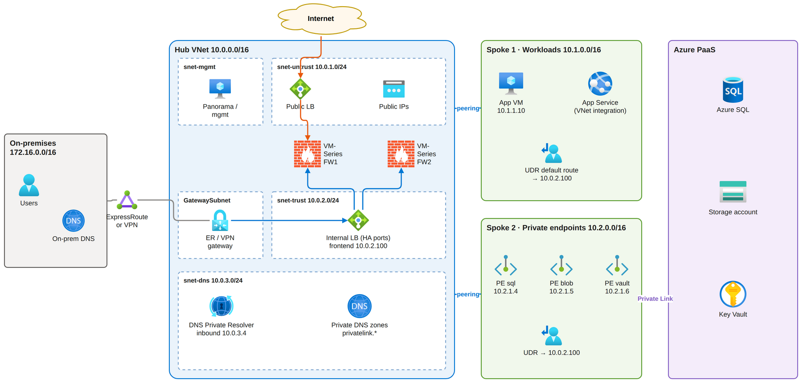

# Securing Azure PaaS behind a Palo Alto firewall in the hub VNet

A 27-minute narrated lecture (1080p, separate English SRT) on every way to put Azure PaaS services such as Azure SQL, Storage and Key Vault behind a Palo Alto Networks firewall in a hub-and-spoke network. It goes deepest on the routing and DNS that actually force private endpoint traffic through the firewall.

Video: coming soon

This is a concept lecture built from draw.io diagrams. There is no live Azure deployment.

## Contents

| Path | What it is |
|---|---|
| `azure-paas-palo-alto-diagrams.drawio` | 20 editable diagram pages (Azure stencils plus draw.io network firewall shapes) |
| `diagrams/` | PNG export of every page |
| `lecture-script.md` | Full narration by chapter with timestamps, the addressing plan and sources |
| `Azure-PaaS-behind-Palo-Alto-hub-lecture.en.srt` | English subtitles |
| `chapters.txt` | YouTube chapter list |
| `source/` | Python generator: diagrams (`diagrams.py`, `dlib.py`), script (`lesson.py`), step rendering (`build.py`, `rend.py`) and frame/SRT composition (`compose.py`) |

## Chapters

```
0:00 Introduction
0:54 Reference topology
3:26 The options map
4:21 Option A · Public endpoint + IP rules
5:50 Option B · Service endpoints
7:47 Option C · Private endpoints and DNS
11:22 Option C · Routing through the firewall
16:44 Option C · Palo Alto configuration
19:00 Option D · VNet injection
19:56 Option E · Outbound from PaaS
21:11 Option F · Inbound publishing
22:28 Option G · Network Security Perimeter
23:23 Option H · Firewall form factors
24:35 Defense in depth and troubleshooting
26:15 Decision guide
```

## Reference topology



| Item | Value |
|---|---|
| Hub VNet | 10.0.0.0/16: untrust 10.0.1.0/24, trust 10.0.2.0/24, DNS 10.0.3.0/24, GatewaySubnet |
| VM-Series | ethernet1/1 untrust 10.0.1.4, ethernet1/2 trust 10.0.2.4 (FW2 10.0.2.5) |
| Internal load balancer (HA ports) | 10.0.2.100, the next hop for every UDR |
| DNS Private Resolver inbound | 10.0.3.4 |
| Spoke 1 workloads | 10.1.0.0/16 (App VM 10.1.1.10) |
| Spoke 2 private endpoints | 10.2.0.0/16 (SQL 10.2.1.4, blob 10.2.1.5, Key Vault 10.2.1.6) |
| On-premises | 172.16.0.0/16 |

## The key rules

1. **Service endpoints**: enable them on the firewall's egress subnet, not the workload subnet. The service endpoint route is more specific than the default route and bypasses the firewall.
2. **Private endpoints**: turn on `privateEndpointNetworkPolicies` (`RouteTableEnabled` or `Enabled`) on the endpoint subnet, then add a UDR on client subnets that is at least as specific as the endpoint VNet's address space (here 10.2.0.0/16 → 10.0.2.100). A default route alone never overrides the /32.
3. **Symmetry**: SNAT on the firewall toward the endpoints, or tag every dataplane NIC with `disableSnatOnPL = true` to keep the client IP.
4. **On-premises**: add a GatewaySubnet route table for the endpoint prefixes to the ILB. Keep gateway route propagation on, and never add a default route there.
5. **DNS**: centralize the privatelink zones, forward the public zone (for example `blob.core.windows.net`) from on-premises to the resolver inbound endpoint, and point the firewall's DNS at the resolver so FQDN objects resolve privately.
6. **PAN-OS**: override `intrazone-default` to deny and log, because spoke-to-spoke traffic is intrazone TRUST. Add health probe routes and a management profile for 168.63.129.16. SQL Redirect over Private Link needs a wide port range, so use Proxy (1433) or open the range to the SQL endpoint only.

## Rebuilding the video

Requires draw.io desktop (run under `xvfb-run`), Python 3 with Pillow, and ffmpeg. Narration was generated with a text-to-speech voice from `txt/*.txt`. Those files are written by `build.py`.

```bash
cd source
python3 build.py --render   # writes txt/, steps.json and steps/*.png
# generate audio/sNNN.wav for each txt/sNNN.txt with any TTS
python3 compose.py          # frames, final.srt, chapters, audio and video concat lists
ffmpeg -f concat -safe 0 -i alist.txt -c:a pcm_s16le narration.wav
ffmpeg -f concat -safe 0 -i vlist.txt -i narration.wav -vf "fps=30,format=yuv420p" \
  -c:v libx264 -crf 20 -tune stillimage -c:a aac -b:a 160k -shortest final.mp4
```

## Sources

- [Azure Firewall scenarios to inspect traffic destined to a private endpoint](https://learn.microsoft.com/azure/private-link/inspect-traffic-with-azure-firewall)
- [Manage network policies for private endpoints](https://learn.microsoft.com/en-us/azure/private-link/disable-private-endpoint-network-policy)
- [Disable SNAT requirement for private endpoint traffic through an NVA](https://learn.microsoft.com/en-us/azure/private-link/private-link-disable-snat)
- [Secure traffic destined to private endpoints in Azure Virtual WAN](https://learn.microsoft.com/azure/firewall-manager/private-link-inspection-secure-virtual-hub)
- [Virtual WAN routing intent and routing policies](https://learn.microsoft.com/en-us/azure/virtual-wan/how-to-routing-policies)
- [Azure Private Endpoint DNS integration scenarios](https://learn.microsoft.com/en-us/azure/private-link/private-endpoint-dns-integration)
- [Azure Firewall FAQ (service endpoints on the firewall subnet)](https://learn.microsoft.com/en-us/azure/firewall/firewall-faq)
- [App Service virtual network integration routing](https://learn.microsoft.com/azure/app-service/configure-vnet-integration-routing)
- [Network Security Perimeter concepts](https://learn.microsoft.com/en-us/azure/private-link/network-security-perimeter-concepts)
- [Azure SQL Private Link and Redirect connection policy](https://learn.microsoft.com/en-us/azure/azure-sql/database/private-endpoint-overview)
- [Front Door Premium Private Link origins](https://learn.microsoft.com/azure/frontdoor/private-link)
- [Palo Alto Networks Azure Transit VNet deployment guide](https://www.paloaltonetworks.com/apps/pan/public/downloadResource?pagePath=/content/pan/en_US/resources/guides/azure-transit-vnet-deployment-guide)
- [Panorama Azure plugin monitoring](https://docs.paloaltonetworks.com/vm-series/deployment/public-cloud/set-up-the-vm-series-firewall-on-azure/vm-monitoring-on-azure/set-up-vm-monitoring-on-azure)
- [Cloud NGFW for Azure hub-and-spoke](https://docs.paloaltonetworks.com/cloud-ngfw-azure/deployment/cloud-ngfw-for-azure-deployment-architectures/cloud-ngfw-for-azure-hub-and-spoke-virtual-networks) and [Virtual WAN](https://docs.paloaltonetworks.com/cloud-ngfw-azure/deployment/cloud-ngfw-for-azure-deployment-architectures/cloud-ngfw-for-azure-virtual-wan)
