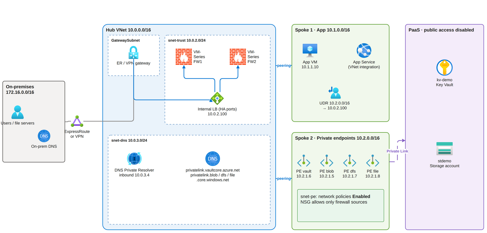
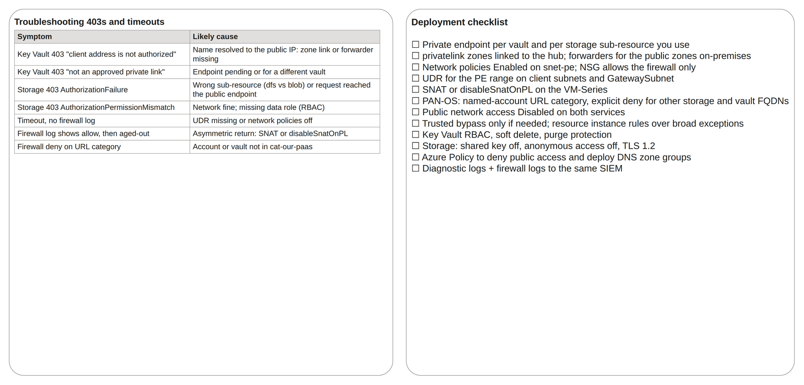

# Securing Azure Key Vault and Storage behind a Palo Alto firewall

A 12-minute narrated lecture (1080p, separate English SRT) on putting Azure Key Vault and Azure Storage behind a Palo Alto Networks VM-Series firewall in a hub-and-spoke network. It follows on from the general [Azure PaaS behind Palo Alto lecture](../2026-11-25_1920_azure-paas-palo-alto-hub/) and goes deep on what is specific to these two services: DNS zones, Storage sub-resources, routing, PAN-OS policy, firewall exceptions, data exfiltration and on-premises access.

## Watch

**[▶ Securing Azure Key Vault and Storage behind a Palo Alto Firewall](https://youtu.be/-vmg5SZ58jM)**

https://youtu.be/-vmg5SZ58jM

This is a concept lecture built from draw.io diagrams. There is no live Azure deployment.

> **Correction to the [5:49 routing chapter](https://youtu.be/-vmg5SZ58jM?t=349) and the checklist graphic:** The endpoint subnet NSG matches the source IP that arrives at the private endpoint. Allowing only the firewall's trust addresses applies **only** to the SNAT design. The other design preserves the original source.
>
> - **Firewall SNAT:** Allow the actual translated source IPs used by the firewalls, such as `10.0.2.4` and `10.0.2.5` in this example if those are the configured SNAT addresses. Scope the rule to the required endpoint IPs and TCP 443.
> - **Source preservation with `disableSnatOnPL=true`:** With no firewall SNAT for this flow, allow only the required original workload and on-premises client IPs or prefixes to the required endpoint IPs on TCP 443. A rule restricted to firewall trust addresses does not match that traffic.
>
> An NSG source match does not prove the packet traversed the firewall. Enable the necessary route-table and NSG policies on the endpoint subnet, verify the effective forward and return paths, and match a new test connection to the Palo Alto session or traffic log. See Microsoft's [private endpoint SNAT guidance](https://learn.microsoft.com/en-us/azure/private-link/private-link-disable-snat) and [NSG rule matching](https://learn.microsoft.com/en-us/azure/virtual-network/network-security-groups-overview#security-rules).

## Contents

| Path | What it is |
|---|---|
| `azure-keyvault-storage-palo-alto-diagrams.drawio` | 11 editable diagram pages (Azure stencils plus draw.io network firewall shapes) |
| `diagrams/` | PNG export of every page |
| `lecture-script.md` | Full narration by chapter with timestamps and sources |
| `Azure-KeyVault-Storage-behind-Palo-Alto-lecture.en.srt` | English subtitles |
| `chapters.txt` | YouTube chapter list |
| `source/` | Python generator: diagrams (`diagrams.py`, `dlib.py`), script (`lesson.py`), step rendering (`build.py`, `rend.py`) and frame/SRT composition (`compose.py`) |

## Chapters

| Time | Chapter |
|---|---|
| [0:00](https://youtu.be/-vmg5SZ58jM?t=0) | Introduction |
| [0:37](https://youtu.be/-vmg5SZ58jM?t=37) | Reference topology |
| [1:49](https://youtu.be/-vmg5SZ58jM?t=109) | Control plane vs data plane |
| [2:49](https://youtu.be/-vmg5SZ58jM?t=169) | Key Vault private endpoint |
| [4:29](https://youtu.be/-vmg5SZ58jM?t=269) | Storage sub-resources |
| [5:49](https://youtu.be/-vmg5SZ58jM?t=349) | Routing through the firewall |
| [6:49](https://youtu.be/-vmg5SZ58jM?t=409) | Palo Alto configuration |
| [8:14](https://youtu.be/-vmg5SZ58jM?t=494) | Trusted services and exceptions |
| [9:14](https://youtu.be/-vmg5SZ58jM?t=554) | Stopping data exfiltration |
| [10:07](https://youtu.be/-vmg5SZ58jM?t=607) | On-premises access |
| [10:56](https://youtu.be/-vmg5SZ58jM?t=656) | Troubleshooting and checklist |

## Reference topology



| Item | Value |
|---|---|
| Hub VNet | 10.0.0.0/16: trust 10.0.2.0/24, DNS 10.0.3.0/24, GatewaySubnet |
| VM-Series | trust interface 10.0.2.4 (FW2 10.0.2.5) |
| Internal load balancer (HA ports) | 10.0.2.100, the next hop for every UDR |
| DNS Private Resolver inbound | 10.0.3.4 |
| Spoke 1 workloads | 10.1.0.0/16 (App VM 10.1.1.10, App Service with VNet integration) |
| Spoke 2 private endpoints | 10.2.0.0/16: Key Vault 10.2.1.6, blob 10.2.1.5, dfs 10.2.1.7, file 10.2.1.8 |
| On-premises | 172.16.0.0/16 |

## Deployment checklist



- Private endpoint per vault and per storage sub-resource you use (blob, dfs, file, queue, table, web)
- privatelink zones linked to the hub; on-premises forwarders for the public zones (`vault.azure.net`, `vaultcore.azure.net`, `blob.core.windows.net`, ...) to the resolver inbound endpoint
- Enable the endpoint subnet's NSG and route-table network policies. Use the actual SNAT addresses or the required original client prefixes as the endpoint NSG source, according to the design above; verify rule priority and effective routing.
- UDR for the private endpoint range on client subnets and the GatewaySubnet
- SNAT on the VM-Series, or `disableSnatOnPL` to keep client IPs
- PAN-OS: custom URL category with your named accounts and vaults, explicit deny for every other storage and vault FQDN
- Public network access Disabled on both services
- Trusted-services bypass only if needed; prefer resource instance rules
- Key Vault RBAC, soft delete and purge protection
- Storage: shared key off, anonymous access off, minimum TLS 1.2
- Azure Policy to deny public access and deploy DNS zone groups
- Diagnostic logs and firewall logs to the same SIEM

## Rebuilding the video

Requires draw.io desktop (run under `xvfb-run`), Python 3 with Pillow, and ffmpeg. Narration was generated with a text-to-speech voice from `txt/*.txt`. Those files are written by `build.py`.

```bash
cd source
python3 build.py --render   # writes txt/, steps.json and steps/*.png
# generate audio/sNNN.wav for each txt/sNNN.txt with any TTS
python3 compose.py          # frames, final.srt, chapters, audio and video concat lists
ffmpeg -f concat -safe 0 -i alist.txt -c:a pcm_s16le narration.wav
ffmpeg -f concat -safe 0 -i vlist.txt -i narration.wav -vf "fps=30,format=yuv420p" \
  -c:v libx264 -crf 20 -tune stillimage -c:a aac -b:a 160k -shortest final.mp4
```

## Sources

- [Azure private endpoint DNS zone values](https://learn.microsoft.com/en-us/azure/private-link/private-endpoint-dns)
- [Key Vault network security](https://learn.microsoft.com/en-us/azure/key-vault/general/network-security)
- [Use private endpoints for Azure Storage](https://learn.microsoft.com/en-us/azure/storage/common/storage-private-endpoints)
- [Azure Storage network security](https://learn.microsoft.com/en-us/azure/storage/common/storage-network-security)
- [Best practices for storage network security](https://learn.microsoft.com/en-us/troubleshoot/azure/azure-storage/blobs/networking/best-practices-for-storage-network-security)
- [Trusted Azure services for Storage](https://learn.microsoft.com/en-us/azure/storage/common/storage-network-security-trusted-azure-services)
- [Troubleshoot 403 errors with private endpoints](https://learn.microsoft.com/troubleshoot/azure/private-link/troubleshoot-403-access-denied-private-endpoint)
- [Manage network policies for private endpoints](https://learn.microsoft.com/en-us/azure/private-link/disable-private-endpoint-network-policy)
- [Network Security Perimeter concepts](https://learn.microsoft.com/en-us/azure/private-link/network-security-perimeter-concepts)
