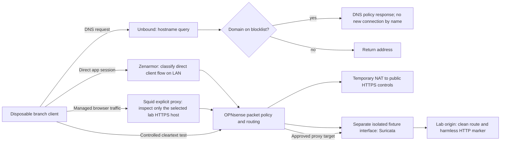

# Build and prove a layered branch firewall with OPNsense

This lab compares overlapping functions, not product parity. It uses only
disposable clients, synthetic application data and a dedicated lab firewall.
The setup checklist is distinct from the observations recorded below; results
not yet confirmed by the lab are not presented as enforcement.

## Why four components?

A branch needs ordinary internet access, but staff should only be able to use
approved web pages, recreational applications should be identifiable, and a
known unwanted traffic pattern should be visible or blocked. These are different
questions. DNS has a name, an application classifier has a session, a proxy has
an HTTP request, and IPS sees only the packets that reach its interface.



Proxy traffic and direct traffic are distinct tests. Do not assume the
upstream Squid session keeps the source IP or app attribution of the client's
original session. Do not apply two TLS interception engines to one client
path. Keep Zenarmor on the client-facing interface and keep Suricata's
netmap capture off that interface. A monitor-only capture may be used first.
Record which Suricata mode was selected in the real appliance.

## What the isolated run verified

| Component | Observed | What this does not establish |
|---|---|---|
| OPNsense | 26.7.10, temporary outbound lab internet path | Production readiness |
| Unbound | `portal.branch.test` returned `198.18.83.10`; the lab policy returned `0.0.0.0` for `example.org` | Blocking direct-IP or encrypted DNS clients |
| Squid 7.7 | Explicit proxy TCP 3128: a verified TLS tunnel connected (CONNECT 200, HTTP 200); two verified TLS legs; the same lab HTTPS origin returned `/docs` 200, `/uploads` 403, then another successful `/docs` in Firefox; curl recorded CONNECT 200 and TLS verification result 0 on both paths | Policy by username, or OPNProxy GUI path enforcement |
| Suricata | IDS let the fixture request through and logged SID 1000383; Netmap IPS on OPT1 blocked the replay, and `/health` still gave HTTP 200 on the same port. EVE GUI recorded the action. | General real-world attack detection/coverage |
| Zenarmor Free 2.7.4 | LAN-only SQLite configuration, no paid trial; optional cloud intelligence and telemetry off. The engine was stopped when first checked and was started in its GUI. A YouTube-only Default App Controls toggle persisted, YouTube then failed, and GitHub stayed HTTP 200 on the same TCP port; the Blocks report identified the YouTube policy match. | A Zenarmor browser block page or app-policy coverage outside this test |

The fixture signature uses a benign request path. It demonstrates the difference
between alerting and enforcement, not exploit detection. The public controls use
ordinary anonymous HTTPS requests; the fixture has synthetic data only.

## Setup in recording order

1. **Topology and baseline:** in a new GNS3 project, connect an OPNsense node
   to three separate segments. The management/browser and test clients are
   on LAN; the isolated origin sits on its own OPT1; WAN uses temporary
   outbound NAT. No inbound forwarding, physical bridge, customer routes,
   or production CA. Choose sufficient disk for packages and reporting.
   Write down active interface names, route/NAT, appliance and plugin versions.
2. **Software map:** Unbound and Suricata are bundled. Install `os-squid`
   from System → Firmware → Plugins. OPNProxy was considered for GUI-based
   path and user rules but is not required for the tested native Squid ACL.
   For Zenarmor
   install `os-sunnyvalley` then `os-sensei` per the official guide.
   Use the Free tier if supported, local reports, and only the test LAN.
   Enable no paid trial or subscription. Record what the wizard really offers.
3. **Unbound / DNS policy:** create a local Host Override for
   `portal.branch.test` → `198.18.83.10`. Test it and a separate lab-defined
   blocked name through the same resolver. Record the DNS response code and
   report. Make sure the test client actually uses the lab resolver.
4. **Zenarmor / direct application flow:** start observing a direct client
   HTTPS request to a known app; pick the app after confirming its label in
   the live report. Turn on an app block, replay from the same endpoint,
   and show a second, distinct HTTPS application still works over TCP 443.
   If only a one-policy Free tier is available, do not imply per-user rules.
5. **Squid / explicit proxy:** point only the managed test client at the
   proxy. First show successful tunneling without decryption. Then demonstrate
   path inspection for the lab origin only using disposable trust: allow
   `/docs`, deny `/uploads`, same scheme, domain, and port. The test client
   must trust the Squid inspection CA; Squid must trust the distinct origin
   CA. Do not disable upstream certificate verification. Apply the scoped
   native ACL as described below. Log the two paths
   and show the denied request does not reach the origin. Disallow direct
   access to this origin over 443 for the proxy-only client and verify it
   separately; do not bypass or weaken TLS for real websites.
6. **Suricata / known pattern:** use an innocuous deterministic marker
   request to the mock origin over cleartext HTTP on 8080 and the supplied
   local test signature. First show the clean control `/health` and the
   marker `/ids-check` each return 200; enable alert-only and match the event
   to the actual client IP, destination and SID. Enable the narrow drop
   action if the selected IPS mode supports it. Replay both and show the
   marker is blocked and the control still passes. A benign signature
   checks policy wiring; it doesn't show effectiveness against real threats.
7. **End-to-end and teardown:** prove normal HTTPS still works where
   permitted and the three denials (DNS, application, URL path) still
   hit their intended layers. Test a configuration rollback and repeat the
   corresponding positive check. Detach the external adapter, remove lab-only
   forwarding, stop the disposable appliance and retain no credentials or keys
   in output. Export full-screen narrated 1080p in downloadable chapters.

## Companion checks

Run `./verify-branch.sh --help` on a disposable Linux client with BIND
`dig` and `curl`. The verifier covers ordinary/filtered DNS, direct
origin HTTP bodies over verified TLS, proxied HTTP and CONNECT results,
and the expected IDS/IPS fixture reachability. For the proxy test,
always corroborate with the matching browser and proxy/origin logs.
For IDS/IPS, use the GUI event with SID 1000383 for alert/drop proof;
the script cannot infer a firewall action from an absent response.
Reproduce the Zenarmor test separately using the preceding manual checks;
the scripts do not configure or query Zenarmor.

Local package checks: shell and Python syntax passed; all five fixture
routes matched the expected status and body over an ephemeral loopback
listener; mocked proxy replies exercised the 200/403 case and confirmed
that a curl TLS error fails verification even when it reports a matching
HTTP/CONNECT pair. The browser, curl, DNS and decision-point observations
above are from the actual isolated appliance, not those fixture tests.

## Evidence to pair with every demo

| Control | Positive case | Negative case | Proof at decision point |
|---|---|---|---|
| Unbound | Lab portal resolves | Test domain denied | Exact code/result and resolver decision |
| Zenarmor | Different HTTPS app still loads | Confirmed application denied on 443 | App label, source, action; same destination ports aren't an app policy |
| Squid | Same-origin `/docs` returns 200 | Same-origin `/uploads` denied | Verified TLS issuer, proxy log; no `/uploads` at origin |
| Suricata | `/health` returns 200 | `/ids-check` hits SID 1000383 | IDS alert vs IPS drop explicitly shown |

## Cost comparison scope

Record the real Zenarmor edition and edition limits on camera. Squid supplies
the managed test client's URL-path feature without buying paid Zenarmor TLS;
this does **not** imply the Free tier supports Zenarmor URL-path rules.
Compare hardware, local logging, administration, certificate distribution,
support, and any paid features separately. Compare against your actual
PAN-OS subscription and renewal quote. This lab does not demonstrate
equivalent app signatures, User-ID coverage, PAN-DB, WildFire, inline phishing
verdicts, centralized operations, HA, or production throughput.

## Operating and support considerations

OPNsense's official plugin inventory marks the `os-squid` and `os-OPNProxy`
integrations **not maintained**. That is the integration status, not a statement
that upstream Squid itself is unmaintained. A successfully demonstrated lab
does not establish suitability for a production security control. Validate
patch ownership, update and compatibility testing, exception handling, CA
rotation, and the availability of supported alternatives separately.
The OPNProxy guide documents Redis and precedence of global proxy rules; a
blanket global rule can prevent OPNProxy's path policy from being evaluated.

## Zenarmor: application policy, not a port block

This run used Zenarmor Free 2.7.4, the Default policy, and the emulated
routed LAN interface `vtnet0`. The engine initially showed Stopped and
was started in the GUI. Verify the engine says Running before relying
on policy observations. No paid trial was used.

From the guest client at `192.168.1.12`, test one anonymous request to
`www.youtube.com:443` and another to `github.com:443`. The recording used
`curl --resolve` with each host's separately verified, real public address
to hold DNS constant between before and after requests. Resolve your own
current addresses, not an archived CDN record. `--resolve` preserves the
HTTPS hostname and certificate checks; it does not turn off validation.
For example, after supplying `IP` and `HOST` for a single request:

```sh
curl -q --noproxy '*' --resolve "$HOST:443:$IP" \
  --connect-timeout 5 --max-time 12 --silent --show-error \
  --output /dev/null --write-out 'HTTP=%{http_code} verify=%{ssl_verify_result}\n' \
  "https://$HOST/"
printf 'curl exit=%s\n' "$?"
```

1. Confirm both direct HTTPS controls return HTTP 200 before the change.
2. In Zenarmor's Default **App Controls**, block only YouTube and click
   **Apply Changes**. Reopen the policy to confirm that setting persisted.
3. Replay the exact requests. YouTube returned curl exit **35**, HTTP
   **000**, with TLS unexpected EOF; GitHub still returned **200** with
   TLS verification result **0**. HTTP 000 means there was no HTTP
   response, not that the firewall returned an HTTP status code.
4. Correlate the failure with Zenarmor **Blocks**. The verified event
   matched client `192.168.1.12`, `www.youtube.com:443`, `vtnet0`,
   policy `Default`, reason **Youtube access**. The event and unchanged
   GitHub control support an application policy result; TLS EOF alone
   does not. No Zenarmor browser block page was shown. The genuine
   Firefox Access Denied page came from Squid in the separate test.

## Native Squid path policy for this disposable lab

The attempted OPNProxy GUI policy rows did not persist or enforce reliably
in this lab. The verified policy used Squid's own `http_access` and
`urlpath_regex`, not OPNProxy or a GUI-only workflow. The
[`branch-lab-squid-path.conf`](branch-lab-squid-path.conf) file contains only
the verified ACL rules, with no certificates, credentials or device shell
automation.

1. Back up the disposable firewall and keep local console access. In the GUI,
   configure the explicit LAN-only proxy on TCP 3128 and set up TLS bump for
   the dedicated fixture hostname only. Leave real sites outside inspection.
   Distribute only the generated public inspection certificate to the test
   browser, and configure Squid to verify the origin against its separate
   lab trust anchor. Do not set a broad certificate exception.
2. Confirm the generated `/usr/local/etc/squid/squid.conf` actually includes
   `include /usr/local/etc/squid/pre-auth/*.conf` and that the intended
   explicit listener is `192.168.1.1:3128` with `ssl-bump`. Stop if your
   version or config differs; do not create an unsupported include or edit
   the generated main config. Restoring one appliance's generated config
   on another is not part of the lab.
3. On the disposable appliance only, save the provided text as the distinct,
   previously unused file
   `/usr/local/etc/squid/pre-auth/45-branch-lab-path.conf`. Confirm that
   the global safety denies still apply. Run
   `/usr/local/sbin/squid -f /usr/local/etc/squid/squid.conf -k parse`.
   This checks the generated configuration and its includes without
   activating the policy. If parsing fails, move the new file out of the
   include directory and do not reload. If it passes, run the same command
   with `-k reconfigure` to reload, then immediately test the controls.
4. To roll back, move **only** `45-branch-lab-path.conf` outside the include
   directory, parse again, then reconfigure. Verify the previous baseline
   from the same test client. Disable lab TLS bump and remove the disposable
   browser profile and its CA trust when finished. After appliance upgrades
   or GUI regeneration, do not assume this custom include still works.

The rules match the staff source `192.168.1.11/32`, the exact lab hostname
`portal.branch.test`, and destination port 443. The CONNECT stage has no
HTTP path, so it gets a scoped allow. The decrypted request separately
allows `/docs` and denies `/uploads`; the last rule denies other requests
only for that same three-way scope. The optional query string does not turn
a longer path such as `/docs-other` into an allowed match. The rules are
source-IP based, not a user-authentication or production access policy.
The standard Squid **Access Denied** error page is not proof by itself;
pair it with a same-origin allow, HTTP/CONNECT status, and TLS verification.

## Firefox proof and reproduction

In the recorded run, the same disposable Firefox profile was used for
all three requests from the staff endpoint (`192.168.1.11`). Only the
public Branch Lab Squid CA certificate was added to that profile's NSS
store with TLS CA trust (`C,,`), with no browser bypass. The first `/docs`
loaded `DOCS_OK`, `/uploads` showed the Squid Access Denied page, and a
repeat of `/docs` still worked. Independent curl runs returned origin
HTTP 200 and proxy HTTP 403, CONNECT 200 for both, and TLS verification
result 0 for both.

Use a disposable browser profile and only the lab trust chain. First check a
public HTTPS control without decryption. Then use the managed lab proxy path
for `https://portal.branch.test/docs` and `https://portal.branch.test/uploads`
with the same profile. DevTools **Network** should show each HTTP status and
the browser certificate viewer should identify the expected lab inspection CA.
Compare the two browser requests with proxy and origin logs. A proxy error page,
a guessed status, or an absent origin log is insufficient on its own.
Do not distribute or leave the lab CA trusted in a normal browser profile.

## Primary references

- [OPNsense Unbound](https://docs.opnsense.org/manual/unbound.html#blocklists)
- [OPNsense Squid plugin and error-page options](https://docs.opnsense.org/manual/proxy.html#custom-error-pages)
- [Squid v7 http_access directive](https://www.squid-cache.org/Doc/config/http_access/)
- [OPNsense OPNProxy, including dependencies and global-policy precedence](https://docs.opnsense.org/manual/opnproxy.html)
- [OPNsense official plugin inventory and maintenance labels](https://github.com/opnsense/plugins#readme)
- [OPNsense Suricata modes](https://docs.opnsense.org/manual/ips.html)
- [Zenarmor setup](https://docs.opnsense.org/vendor/sunnyvalley/zenarmor_install.html)
- [Zenarmor coexistence](https://www.zenarmor.com/docs/support/faq-compatibility)
- [Zenarmor editions](https://www.zenarmor.com/plans)
- [Palo Alto App-ID](https://docs.paloaltonetworks.com/ngfw/administration/app-id/app-id-overview)
- [Palo Alto Advanced URL Filtering](https://docs.paloaltonetworks.com/advanced-url-filtering/administration/url-filtering-basics/how-url-filtering-works)
