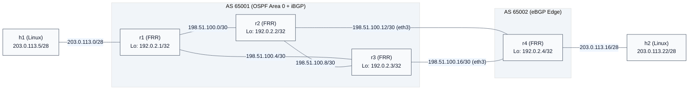

# Netlab Local NetOps Lab (OSPF + BGP on Containerlab)

A reproducible local NetOps lab built with **[netlab](https://netlab.tools/)** (`ipspace/netlab` by Ivan Pepelnjak), running on Windows with WSL `Ubuntu-24.04` and Docker via `containerlab` (`provider: clab`).

## What Is netlab?

`netlab` is an open-source network-lab-as-code tool created by Ivan Pepelnjak (`ipspace/netlab`). Instead of writing container manifests, IP plans, and routing configurations by hand, you describe a topology and routing protocols in a single YAML file (`topology.yml`). From that file, `netlab` automatically:

- Allocates loopbacks, point-to-point links, host LANs, and management addresses.
- Generates the Containerlab topology (`clab.yml`) and Ansible inventory (`hosts.yml`, `group_vars/`, `host_vars/`).
- Boots the lab containers and applies initial, OSPF, BGP, and Linux routing configurations.
- Provides unified CLI helpers (`netlab status`, `netlab inspect`, `netlab report`, `netlab connect`, `netlab validate`, `netlab graph`, `netlab down`).

### Why Containerlab + Free FRR and Linux Images?

This lab uses only free, publicly pullable open-source container images—no vendor NOS licenses, portals, or sign-ups are required:

- **Routers (`r1`–`r4`)**: `quay.io/frrouting/frr:10.7.1` (FRRouting, `device: frr`)
- **Hosts (`h1`, `h2`)**: `python:3.13-alpine` (`device: linux`)

## Topology Overview



### Container Prefix, Ports, and Addressing

- **Container prefix**: `netlab-demo` (Containerlab creates `clab-netlab-demo-r1` through `clab-netlab-demo-r4`, `clab-netlab-demo-h1`, and `clab-netlab-demo-h2`).
- **Published host ports**: **None (`0` host ports published)**. All node management traffic stays on the isolated Docker bridge `netlab-demo-mgmt` (`192.168.250.0/24`), and data-plane links use Containerlab point-to-point `veth` pairs.
- **Data-plane addressing (RFC 5737 only)**:
  - **Loopbacks**: `192.0.2.0/24` (`r1` `192.0.2.1/32`, `r2` `192.0.2.2/32`, `r3` `192.0.2.3/32`, `r4` `192.0.2.4/32`)
  - **Point-to-point links**: `198.51.100.0/24` (`/30` subnets: `r1-r2` `.0/30`, `r1-r3` `.4/30`, `r2-r3` `.8/30`, `r2-r4` `.12/30`, `r3-r4` `.16/30`)
  - **Host stub LANs**: `203.0.113.0/24` (`/28` subnets: `h1-r1` `203.0.113.0/28`, `h2-r4` `203.0.113.16/28`)
  - **Management bridge**: `192.168.250.0/24` (`netlab-demo-mgmt`, `r1..r4` `.11..14`, `h1..h2` `.15..16`), selected to avoid pre-existing Docker bridges on the host.

## Runbook

### Prerequisites

- Windows host with WSL `Ubuntu-24.04` and a running Docker daemon.
- Install `netlab`, `containerlab`, `ansible`, `graphviz`, and `sshpass` inside WSL:
  ```bash
  wsl -d Ubuntu-24.04 -u root -e bash scripts/install-netlab.sh
  ```

### Step-by-Step Lifecycle

Run from this lab directory inside WSL (for example `/mnt/c/Users/<you>/demo-labs/2026-11-27-netlab`). If the directory is on `/mnt/c/...`, export `ANSIBLE_CONFIG="$PWD/ansible.cfg"` so Ansible will use the generated config:

1. **Start the lab**:
   ```bash
   netlab up
   ```
2. **Check status, reports, and transformed data model**:
   ```bash
   netlab status
   netlab report addressing
   netlab report bgp
   netlab inspect --node r1 ospf
   netlab inspect --node r1 bgp
   netlab inspect --node r4 bgp
   ```
3. **Connect to routers and hosts (`netlab connect`)**:
   ```bash
   netlab connect r1 -- vtysh -c "show ip ospf neighbor"
   netlab connect r2 -- vtysh -c "show ip bgp summary"
   netlab connect r1 -- vtysh -c "show ip route"
   netlab connect r4 -- vtysh -c "show ip route"
   netlab connect h1 -- ip -o -f inet addr show
   netlab connect h1 -- ping -c 4 203.0.113.22
   ```
4. **Run built-in automated validation (`netlab validate`)**:
   ```bash
   netlab validate
   ```
5. **Test an eBGP link failure and recovery (`r2:eth3` -> `r4`)**:
   ```bash
   # Shut down r2 eth3 (198.51.100.12/30 toward r4)
   netlab connect r2 -- vtysh -c "configure terminal" -c "interface eth3" -c "shutdown"
   # Confirm netlab validate catches the broken eBGP session while traffic fails over via r3
   netlab validate ebgp_as65002 --skip-wait || true
   netlab connect r1 -- vtysh -c "show ip route 203.0.113.16/28"
   netlab connect h1 -- ping -c 4 203.0.113.22
   # Restore r2 eth3 and verify full convergence
   netlab connect r2 -- vtysh -c "configure terminal" -c "interface eth3" -c "no shutdown"
   netlab validate
   ```
6. **Generate light-background topology and BGP graphs**:
   ```bash
   netlab graph topology.dot
   netlab graph -t bgp bgp.dot
   dot -Tsvg -Gbgcolor=white topology.dot -o topology.svg
   dot -Tpng -Gbgcolor=white topology.dot -o topology.png
   dot -Tsvg -Gbgcolor=white bgp.dot -o bgp.svg
   dot -Tpng -Gbgcolor=white bgp.dot -o bgp.png
   ```
7. **Tear down the lab and remove generated artifacts**:
   ```bash
   netlab down --cleanup
   ```

To execute all six stages end-to-end automatically:

```bash
wsl -d Ubuntu-24.04 -u root -e bash tests/run-all.sh
```

## What We Observed

All results below were captured from a live run of `tests/run-all.sh` on this machine (total elapsed runtime: **82 seconds**, from `19:01:25Z` to `19:02:47Z`). Raw logs and visual artifacts are stored under `evidence/`.

### Observed Versions

- `netlab`: `26.11` (`/opt/netlab-venv/bin/netlab`)
- `containerlab`: `0.83.0` (`commit fb20edd45`, `2026-11-07`)
- `ansible-core`: `2.21.6` (`community.docker 5.4.1`, `ansible.utils 6.1.1`, `community.general 14.0.1`)
- `graphviz` (`dot`): `2.43.0`
- `Python`: `3.12.3`
- `Docker`: `29.9.3`

### Observed Lab Bring-Up & Routing State

- **`netlab up`** (`evidence/01-netlab-up.txt`): Created Docker network `netlab-demo-mgmt` (`192.168.250.0/24`), started all 6 containers (`clab-netlab-demo-r1`..`r4` on `quay.io/frrouting/frr:10.7.1`, `clab-netlab-demo-h1` and `clab-netlab-demo-h2` on `python:3.13-alpine`) with **0 published host ports**, and deployed `initial`, `ospf`, `bgp`, and `routing` configurations.
- **`netlab status` & `netlab inspect`** (`evidence/02-status-inspect.txt`): Confirmed all 6 containers running (`192.168.250.11`–`.16`), RFC 5737 addressing across loopbacks, `/30` links, and `/28` LANs, and BGP peerings (`AS 65001` full iBGP mesh over loopbacks; dual eBGP uplinks from `r2` and `r3` to `r4` in `AS 65002`).
- **`show` commands & host ping** (`evidence/03-show-commands.txt`):
  - `r1` and `r2` reached OSPF state `Full/-` with their AS 65001 peers.
  - `show ip bgp summary` on `r1`, `r2`, `r3`, and `r4` showed all iBGP and eBGP sessions `Established` with prefixes exchanged.
  - `show ip route` on `r1` showed ECMP recursive BGP routes for `203.0.113.16/28` via both `192.0.2.2` (`eth2`, `198.51.100.2`) and `192.0.2.3` (`eth3`, `198.51.100.6`); `r4` showed ECMP eBGP routes for `203.0.113.0/28` via `198.51.100.13` (`eth2`) and `198.51.100.17` (`eth3`).
  - Baseline `h1 -> h2` ping (`203.0.113.22`): **4 transmitted, 4 received, 0% packet loss**, `min/avg/max = 0.209/0.317/0.451 ms`.
- **`netlab validate`** (`evidence/04-validate-pass.txt`): All 5 test groups (`ospf_r1`, `ospf_core`, `ibgp_as65001`, `ebgp_as65002`, `ping_h1_h2`) passed with **`[SUCCESS] Tests passed: 8`**.
- **Failure & recovery scenario** (`evidence/05-failure-recovery.txt`):
  - Shutting down `r2:eth3` dropped the `r2`–`r4` eBGP session to `Active` on both routers.
  - `r1` immediately failed over `203.0.113.16/28` from dual-path ECMP to a single path via `r3` (`198.51.100.6` on `eth3`).
  - `netlab validate ebgp_as65002 --skip-wait` exited with code `1` and reported `[FAIL] Node r2: The neighbor 198.51.100.14 (r4) is in state Active (expected Established)` while `r3` remained `[PASS]`.
  - End-to-end `h1 -> h2` ping stayed up over the backup `r3`–`r4` path (**4/4, 0% loss**, `min/avg/max = 0.141/0.159/0.172 ms`), and `netlab validate ping_h1_h2` passed.
  - Running `no shutdown` on `r2:eth3` restored the `r2`–`r4` eBGP session to `Established`, and a full `netlab validate` returned **`[SUCCESS] Tests passed: 8`**.
- **Graphs & teardown** (`evidence/06-netlab-down.txt`):
  - `netlab graph` and `netlab graph -t bgp` rendered to light-background SVG and PNG files (`evidence/topology.svg`, `evidence/topology.png`, `evidence/bgp.svg`, `evidence/bgp.png`), embedded alongside observed outputs in `evidence/topology-graph.html` and screenshots in `evidence/screenshots/`.
  - `netlab down --cleanup` removed all 6 `clab-netlab-demo-*` containers, the `netlab-demo-mgmt` network, and generated config files, leaving all 67 pre-existing Docker containers on the host untouched.

## Known Limits

- **WSL `/mnt/c/` permissions and Ansible**: Because the Windows filesystem mounted at `/mnt/c/...` is world-writable in WSL, Ansible ignores a local `ansible.cfg` unless `ANSIBLE_CONFIG=./ansible.cfg` is explicitly exported.
- **Root privileges for Containerlab**: Creating Docker bridges, `veth` pairs, and `/etc/hosts` entries requires root inside WSL (`wsl -d Ubuntu-24.04 -u root ...` or `sudo`).
- **Management subnet selection**: On this host, existing Docker networks already occupied `192.168.112.0/20` (covering netlab's default `192.168.121.0/24`) as well as RFC 5737 bridge subnets, so `topology.yml` pins the Containerlab management bridge to `192.168.250.0/24` (`netlab-demo-mgmt`) while keeping all router and host data-plane addresses strictly within RFC 5737.
- **Free open-source device scope**: Using `frr` and `linux` keeps the lab 100% free and fast (82 seconds end-to-end), but does not exercise commercial vendor NOS CLIs or proprietary features.

## Repository Layout

- `topology.yml` — Declarative `netlab` topology, RFC 5737 addressing, OSPF/BGP groups, and `validate:` checks.
- `scripts/install-netlab.sh` & `scripts/runbook.md` — Reproducible WSL installer and operational quick-reference.
- `testdata/` — Addressing plan (`addressing-plan.yml`), node inventory (`nodes.yml`), and expected checks (`expected-checks.json`).
- `tests/` — Executable 6-stage verification suite (`run-all.sh`, `01-up.sh`–`06-down.sh`).
- `evidence/` — Raw command logs (`00-versions.txt`–`06-netlab-down.txt`), light-background Graphviz diagrams (`topology.*`, `bgp.*`), HTML report (`topology-graph.html`), and screenshots (`evidence/screenshots/`).
- `prompts/PROMPTS.md` — Session prompt record.
