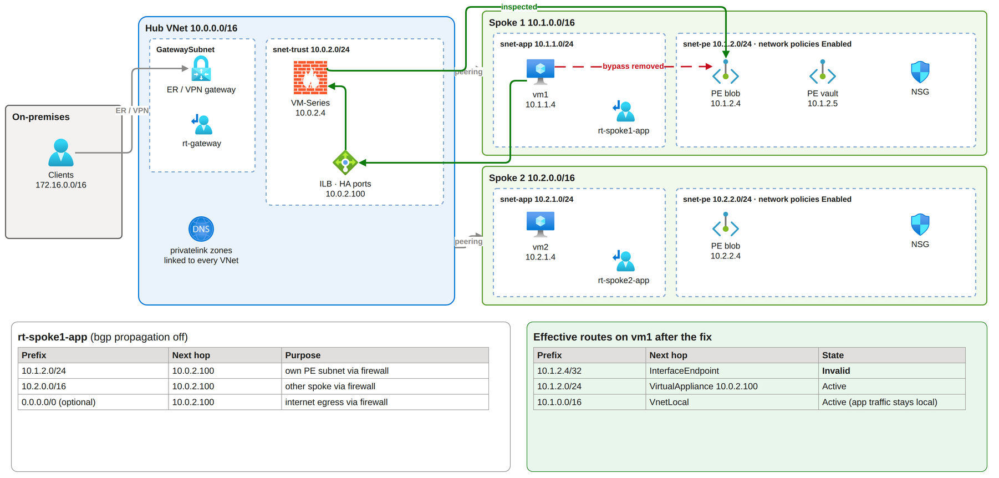

# Private endpoints in spoke VNets: forcing the traffic through a Palo Alto in the hub

An 11-minute narrated lecture (1080p, separate English SRT) plus a Terraform test lab. The use case: every spoke keeps its own private endpoints next to its workloads, and every connection to them has to be inspected by a Palo Alto Networks VM-Series in the hub. It follows on from the [Azure PaaS behind Palo Alto lecture](../2026-11-25_1920_azure-paas-palo-alto-hub/) and the [Key Vault and Storage lecture](../2026-11-25_1958_azure-keyvault-storage-palo-alto/).

## Watch

**[▶ Private Endpoints in Spoke VNets: Forcing Traffic through a Palo Alto Firewall in the Hub](https://youtu.be/eGofFfq1-YA)**

https://youtu.be/eGofFfq1-YA

## The rule in one line

Enable `privateEndpointNetworkPolicies` on the subnet that **hosts the endpoints**. Then add a UDR whose prefix is **at least as long as that endpoint VNet's prefix**, for example the PE subnet `10.1.2.0/24 → 10.0.2.100`. A `0.0.0.0/0` or `10.0.0.0/8` route never overrides the endpoint's /32. Finally, keep the return path on the firewall with source NAT or the `disableSnatOnPL` NIC tag.



| Flow | Route table on | Route to the ILB (10.0.2.100) |
|---|---|---|
| VM → endpoint in the same spoke | the spoke's app subnet | its own PE subnet, e.g. 10.1.2.0/24 |
| VM → endpoint in another spoke | the app subnet | the other spoke's /16 |
| On-premises → endpoint | GatewaySubnet (propagation on) | each spoke's /16, not 10.0.0.0/8 |

On PAN-OS, this traffic enters and leaves on ethernet1/2 (trust → trust, intrazone). Override `intrazone-default` to deny and log, allow app subnets → PE subnets explicitly, and add the source NAT rule.

**NSG on the PE subnet:** it matches the source IP that reaches the endpoint. "Allow only the firewall" proves the path only with SNAT. With `disableSnatOnPL`, it has to allow the client subnets, and the route is your control.

## Terraform test lab

[`terraform/`](terraform/) deploys:

- the hub, with a VM-Series behind an internal load balancer that uses an HA ports rule;
- two spokes, each with a test VM and private endpoints for its storage account, plus a Key Vault endpoint in spoke 1;
- route tables, NSGs and private DNS zones.

It also includes `panos/fw-config.set` (PAN-OS set commands) and `tests/run-tests.sh` (curl from both VMs plus their effective routes). Three variables switch between steering on and off, firewall SNAT or `disableSnatOnPL`, and NSG on or off. The [lab README](terraform/README.md) lists the expected result for each setting.

`terraform validate` passes with Terraform 1.17.2 and azurerm 4.81.0. It hasn't been deployed end to end in Azure, so treat the first apply as a test run. The VM-Series is billed by the hour; run `terraform destroy` when you finish.

## Contents

| Path | What it is |
|---|---|
| `azure-pe-spokes-palo-alto-diagrams.drawio` | 12 editable diagram pages (Azure stencils plus draw.io network firewall shapes) |
| `diagrams/` | PNG export of every page |
| `lecture-script.md` | Full narration by chapter with timestamps, addressing and sources |
| `Azure-PE-in-spokes-through-Palo-Alto-lecture.en.srt` | English subtitles |
| `chapters.txt` | YouTube chapter list |
| `terraform/` | Test lab: Terraform, PAN-OS config, test script |
| `source/` | Python generator for the diagrams, script, frames and SRT |

## Chapters

| Time | Chapter |
|---|---|
| [0:00](https://youtu.be/eGofFfq1-YA?t=0) | Introduction |
| [0:33](https://youtu.be/eGofFfq1-YA?t=33) | Why traffic bypasses the firewall |
| [1:51](https://youtu.be/eGofFfq1-YA?t=111) | The routing rule that fixes it |
| [3:06](https://youtu.be/eGofFfq1-YA?t=186) | Three flows to cover |
| [3:46](https://youtu.be/eGofFfq1-YA?t=226) | Same-spoke traffic |
| [4:40](https://youtu.be/eGofFfq1-YA?t=280) | Keeping the return path symmetric |
| [5:40](https://youtu.be/eGofFfq1-YA?t=340) | Cross-spoke traffic |
| [6:39](https://youtu.be/eGofFfq1-YA?t=399) | On-premises traffic |
| [7:39](https://youtu.be/eGofFfq1-YA?t=459) | Palo Alto configuration |
| [8:35](https://youtu.be/eGofFfq1-YA?t=515) | DNS, guardrails and other layouts |
| [9:29](https://youtu.be/eGofFfq1-YA?t=569) | The Terraform test lab |
| [10:22](https://youtu.be/eGofFfq1-YA?t=622) | Testing and troubleshooting |

## Rebuilding the video

Requires draw.io desktop (run under `xvfb-run`), Python 3 with Pillow, and ffmpeg. Narration was generated with a text-to-speech voice from `txt/*.txt`, which `build.py` writes.

```bash
cd source
python3 build.py --render   # writes txt/, steps.json and steps/*.png
# generate audio/sNNN.wav for each txt/sNNN.txt with any TTS
python3 compose.py          # frames, final.srt, chapters, audio and video concat lists
ffmpeg -f concat -safe 0 -i alist.txt -c:a pcm_s16le narration.wav
ffmpeg -f concat -safe 0 -i vlist.txt -i narration.wav -vf "fps=30,format=yuv420p" \
  -c:v libx264 -crf 20 -tune stillimage -c:a aac -b:a 160k -shortest final.mp4
```

## Sources

- [Manage network policies for private endpoints](https://learn.microsoft.com/en-us/azure/private-link/disable-private-endpoint-network-policy)
- [Firewall scenarios to inspect traffic destined to a private endpoint](https://learn.microsoft.com/en-us/azure/private-link/inspect-traffic-with-azure-firewall)
- [Disable SNAT requirement for private endpoint traffic through an NVA](https://learn.microsoft.com/en-us/azure/private-link/private-link-disable-snat)
- [Azure private endpoint DNS zone values](https://learn.microsoft.com/en-us/azure/private-link/private-endpoint-dns)
- [Secure traffic destined to private endpoints in Azure Virtual WAN](https://learn.microsoft.com/azure/firewall-manager/private-link-inspection-secure-virtual-hub)
- [Virtual WAN routing intent and routing policies](https://learn.microsoft.com/en-us/azure/virtual-wan/how-to-routing-policies)
